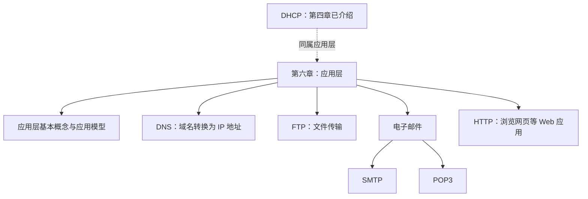

# 第六章 应用层：学习概述

## 一、本章整体介绍

从本节课开始，进入计算机网络最后一章——**应用层**的学习。

从大纲上看，本章涉及的内容似乎比较多，但实际内容并不算多，课后习题也比较少，因此本章大概用 **3～4 天**就可以学完。继续加油，胜利就在眼前。

## 二、本章涉及的主要协议

第六章主要涉及以下协议：

- **DNS**：把域名（网址）转换成 IP 地址。
- **FTP**：主要用于文件传输。
- **SMTP、POP3**：实现电子邮件功能时会用到的协议。
- **HTTP**：与访问网页有关，最熟悉的应用场景是浏览网页。

此外，还有 **DHCP** 协议。第四章已经介绍过 DHCP，它也属于应用层协议；忘记相关内容的同学可以回顾第四章的视频。

### 2.1 协议对比

| 协议 | 主要用途                     | 基于的传输层协议         |
| ---- | ---------------------------- | ------------------------ |
| DNS  | 将域名（网址）转换成 IP 地址 | UDP                      |
| FTP  | 文件传输                     | TCP                      |
| HTTP | 浏览网页等 Web 应用          | TCP                      |
| SMTP | 电子邮件相关功能             | 本段课程未在此处具体说明 |
| POP3 | 电子邮件相关功能             | 本段课程未在此处具体说明 |
| DHCP | 动态主机配置，第四章已介绍   | 本段课程未在此处具体说明 |

> 注：本节口述内容明确提到 DNS 基于 UDP，FTP 和 HTTP 基于 TCP；SMTP、POP3 及 DHCP 的传输层细节在这段讲解中没有展开，因此这里不额外补充。

### 2.2 本章内容关系图

## 三、各小节的学习特点与安排

本章应用层内容分为五个小节。

### 3.1 前三个小节：基本概念与基础知识

前三个小节的特点是：

- 难度不高，但会涉及一些比较零碎的概念。
- 有些内容可能比较抽象。
  - **FTP**：并不是每个同学都使用过。
  - **DNS**：平时上网时，通常感受不到 DNS 的存在；它会在背后默默完成很多工作。
  - 对于跨考同学来说，**客户—服务器模型**和 **P2P 模型**也可能比较抽象。
- 总体来说，前三个小节学习起来并不算特别难，考试难度也不会特别高。

为了尽快推进学习进度，前三个小节采用“**凤凰传奇授课法**”：

- 凤凰传奇有一位女主唱，另一位成员负责说唱。
- 前三个小节由**楼楼老师主讲**，通过视频帮助大家熟悉基本概念和基础知识。
- 另外会提供补充视频，用于解释比较抽象的内容，并强调考试中比较重要的知识点。

### 3.2 第四小节：电子邮件

电子邮件是日常生活中比较常用的内容，因此学习这一部分时，通常不会觉得特别抽象。

所以，第四个小节采用“**女生独唱**”的方式。

### 3.3 第五小节：万维网与 HTTP

最后一个小节是**万维网（WWW）与 HTTP**。

这一部分的考题通常有一定难度，也可能在大题中考察。因此，这一小节的讲解将会全部重新构建。

## 四、学习安排速览

| 小节       | 主要内容                                | 学习特点                             | 授课安排                               |
| ---------- | --------------------------------------- | ------------------------------------ | -------------------------------------- |
| 前三个小节 | 基本概念、应用模型、DNS、FTP 等相关内容 | 难度不高，但概念零碎，部分内容较抽象 | “凤凰传奇授课法”：主讲视频搭配补充视频 |
| 第四小节   | 电子邮件：SMTP、POP3                    | 日常接触较多，比较容易理解           | “女生独唱”                             |
| 第五小节   | 万维网（WWW）、HTTP                     | 考题通常有一定难度，可能考大题       | 讲解内容全部重构                       |

## 五、复习提示

1. 记住本章几个主要协议及其用途：DNS 负责域名解析，FTP 负责文件传输，HTTP 与 Web 访问有关，SMTP 和 POP3 与电子邮件有关。
2. DHCP 属于应用层协议，相关内容已经在第四章介绍过。
3. 前三个小节重点熟悉基本概念，并结合补充视频理解较抽象的内容；学习 HTTP 时要重视其可能出现的大题考查。
