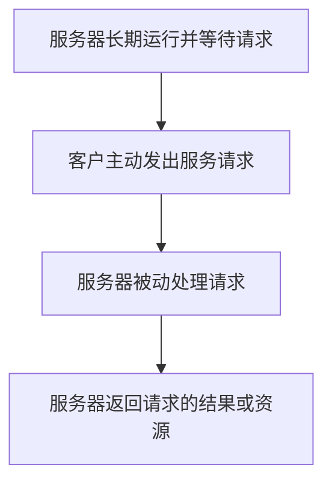
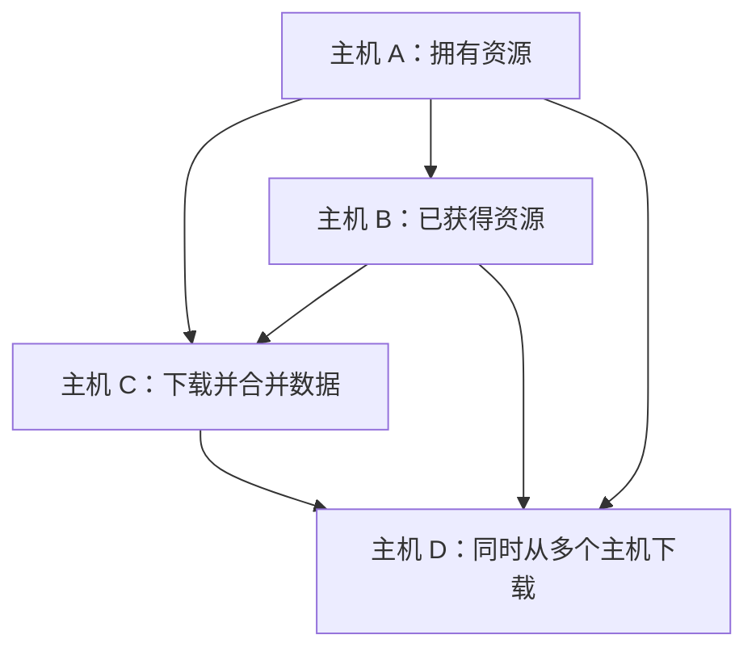

# 网络应用模型：客户—服务器模型与 P2P 模型

## 一、考纲要求与本节概述

从本节开始学习**应用层**。本节考研大纲要求了解网络应用的两种模型：

1. **客户—服务器模型（Client-Server，C/S 模型）**
2. **对等模型（Peer-to-Peer，P2P 模型）**

本节主要考查概念型选择题，需要掌握两种模型的工作方式、特点、优点和缺点。

> **术语说明**
>
> - **C/S**：Client-Server，即客户—服务器。
> - **P2P**：Peer-to-Peer，即对等模型。中间的字母 `P` 代表 Peer，数字 `2` 读作 _two_，因此 `P2P` 读作 _Peer to Peer_。

---

## 二、客户—服务器模型（C/S 模型）

### 2.1 典型例子：百度网盘

百度网盘或其他网盘类产品是典型的 C/S 模型网络应用。

- **客户（客户端）**：安装在个人电脑或手机上的百度网盘应用程序。
- **服务器**：百度公司提供的网盘服务器，本质上也是主机，可以理解为一台性能很强的计算机。
- **现实中的实现**：服务器通常由计算机集群实现，并不一定只对应一台物理主机。为了便于理解，可以先把它简化为一台主机。

### 2.2 C/S 模型的工作流程

C/S 模型的基本工作过程如下：

1. **服务器长期运行，等待客户请求。** 即使暂时没有主机访问，服务器也需要长期运行、处于待命状态，因为任何时刻都可能有新的客户来访问。
2. **客户主机主动发出服务请求。** 例如，电脑上的百度网盘客户端向服务器请求下载某个电影文件。
3. **服务器被动处理请求并返回结果。** 只有客户请求某个资源时，服务器才会按照客户的要求发送资源；如果客户没有提出请求，服务器不会主动把该资源发送给客户。

#### 工作流程图

### 2.3 IP 地址与端口号

在 C/S 模型中，客户主动向服务器发出请求，因此：

- **客户必须提前知道服务器的地址**，具体来说，需要知道服务器的 **IP 地址和端口号**。
- 服务器主机上运行着服务器进程，该进程对应一个端口号。
- 服务器收到请求后，可以从通信中获知客户的 IP 地址和端口号。
- 因此，**服务器不需要提前知道客户的地址**。

| 主机角色 | 是否需要提前知道对方的地址 | 原因                                                         |
| -------- | -------------------------- | ------------------------------------------------------------ |
| 客户端   | 需要                       | 客户端主动向服务器发出请求，必须知道服务器的 IP 地址和端口号 |
| 服务器端 | 不需要                     | 服务器收到请求后，可以获知客户端的 IP 地址和端口号           |

### 2.4 典型的 C/S 网络应用

计算机网络第六章“应用层”中，后续会学习的以下网络应用都属于典型的 C/S 模型：

- DNS
- 电子邮件
- FTP
- Web 应用

### 2.5 C/S 模型的特点

#### 特点一：客户与服务器的地位不平等

服务器处于中心地位，客户围绕服务器请求服务。

#### 特点二：客户之间不会直接通信

例如，你想把电影传给舍友：

1. 你先把电影上传到网盘服务器。
2. 舍友再从网盘服务器下载电影。

因此，客户与服务器之间会直接通信，但客户与客户之间通常不会直接通信。

### 2.6 C/S 模型的优点

**最大的优点：便于集中管理。**

集中管理主要包括以下方面：

- **数据资源**：用户上传的文件由服务器集中管理。服务器可以根据自身的管理规则处理文件，例如处理违规文件。
- **带宽资源**：服务器可以集中分配带宽。例如，免费用户获得的下载带宽可能比较少，而付费用户可能获得更多带宽。带宽资源具有成本，因此服务提供方可以根据服务类型进行分配。

### 2.7 C/S 模型的缺点

#### 缺点一：服务器损坏会影响全局

如果服务器或服务器机房出现故障，依赖该服务器的用户就可能无法使用服务，存放在服务器上的数据也可能受到影响。

#### 缺点二：服务器负载很大

大量客户端可能同时向服务器发送上传或下载请求。由于服务器处于中心位置，所有请求都集中到服务器上，因此服务器的负载较大。

**结论：服务器的性能会影响整个系统的性能。**

---

## 三、对等模型（P2P 模型）

### 3.1 核心思想：去中心化

P2P 模型最重要的思想是**去中心化**。

在 P2P 网络应用中，各台主机的地位是平等的。任意两台主机之间都可以称为**对等方（Peer）**，主机之间可以直接通信。

### 3.2 典型例子：BT 种子下载

以前校园网内部曾经流行使用 BT 下载器，例如 uTorrent。它可以用来理解 P2P 模型的工作方式。

假设主机 A 拥有大家都想下载的资源，例如电视剧《权力的游戏》的一集 `episode.mp4`。

1. **制作 BT 种子**：主机 A 将资源制作成 BT 种子。BT 种子体积很小，通常只有几 KB；而一集高清电视剧可能有 4 GB 甚至更大。
2. **发布种子**：主机 A 将 BT 种子发布到校园网论坛。
3. **获取种子**：其他同学先下载 BT 种子到本地，再用 BT 下载器打开。
4. **从其他主机获取资源**：下载器根据种子的指引，从网络中拥有该资源的主机获取数据。
5. **多个主机同时提供数据**：主机 B 下载完成后，也可以向其他主机提供资源。主机 C 下载时，可以同时从主机 A、主机 B 获取数据，例如 A 发送文件前半部分、B 发送后半部分，最后在 C 上合并成完整文件。
6. **更多主机加入共享**：主机 C 获得完整资源后，也可以向主机 D 提供数据。主机 D 可以同时从 A、B、C 获取文件的不同部分。

> **理解重点：** BT 种子本身不是完整的大文件，而是用于指引下载器获取对应资源的信息。资源可以由网络中多个拥有该资源的主机分别提供。

### 3.3 P2P 下载示意图

上图用于示意资源可以在多个对等主机之间直接传输。实际下载时，各主机可能同时上传和下载文件的不同部分。

### 3.4 P2P 模型的特点

#### 特点一：去中心化

各台主机的地位平等，不需要所有资源都由一个中心服务器统一提供。

#### 特点二：主机之间可以直接通信

例如，在 BT 下载过程中，主机 B 可以直接向主机 C 发送文件数据，不必先把数据传给某个中心服务器，再由服务器转发给 C。

### 3.5 P2P 模型的优点

#### 优点一：单个节点损坏不影响全局

例如，主机 D 想下载某个文件，但主机 A 退网了，或者主机 A 已经删除了本地文件。只要主机 B、主机 C 等其他节点仍然拥有该资源，主机 D 仍然可以从这些节点获取文件。

#### 优点二：各节点可以分摊负载

多个节点都可以提供文件的一部分。主机 D 可以同时从 A、B、C 获取数据，不必完全依赖某一台服务器。

**理解重点：** 节点越多、可提供资源的节点越多时，下载任务就越有机会分摊到多个节点上。

### 3.6 P2P 模型的缺点

#### 缺点一：主机在接受服务的同时，也需要为其他主机提供服务

在 P2P 模型中，一台主机既可以享受其他主机的服务，也需要在拥有资源时为其他主机提供服务。

例如，主机 C 本地保存着某个共享文件。当主机 D 请求该文件时，主机 C 需要读取本地数据并发送给 D。

因此，P2P 模型下主机的负载可能较大。

与之相比，在百度网盘这样的 C/S 应用中，客户端是否上传或下载通常由用户自己的操作决定；如果没有上传或下载任务，客户端通常不需要主动为其他客户端提供文件服务。

#### 缺点二：可能导致网络数据流量增大，造成网络拥塞

P2P 去中心化的特点使主机之间的数据传输不容易由单一中心统一管理。大量主机相互上传、下载数据，可能使网络中的数据流量显著增加，从而导致网络拥塞。

相比之下，C/S 模型中服务器可以集中管理服务资源，并在一定程度上控制带宽分配。

#### 缺点三：可能增加硬盘读写负担

在 P2P 下载应用中，如果主机保存了一个被 BT 共享的文件，其他主机可能不断请求读取该文件的数据。频繁读取和传输会增加硬盘的读写负担。

因此，一些个人或组织会反对某些 P2P 下载应用；对于互联网服务提供商（ISP），例如中国电信、中国联通，大量 P2P 数据传输也可能加重网络负载。

---

## 四、C/S 模型与 P2P 模型对比

| 对比维度         | C/S 模型                                     | P2P 模型                                                   |
| ---------------- | -------------------------------------------- | ---------------------------------------------------------- |
| 核心思想         | 服务器处于中心地位                           | 去中心化                                                   |
| 主机地位         | 客户与服务器地位不平等                       | 各对等主机地位平等                                         |
| 通信方式         | 客户与服务器直接通信，客户之间通常不直接通信 | 主机与主机之间可以直接通信                                 |
| 资源管理         | 便于集中管理数据、带宽等资源                 | 资源分散在各个节点上                                       |
| 负载分配         | 请求集中到服务器，服务器负载可能很大         | 多个节点可以共同提供数据、分摊负载                         |
| 单点故障         | 服务器故障可能影响全局                       | 单个节点退出通常不一定影响全局，只要其他节点仍有资源       |
| 对普通主机的要求 | 客户端通常只需按需上传或下载                 | 主机在接受服务的同时，也可能需要向其他主机提供服务         |
| 网络流量         | 可以集中管理服务器提供的服务与带宽           | 主机之间的数据传输较难集中管理，可能造成较大流量和网络拥塞 |
| 典型例子         | 百度网盘                                     | BT 种子下载、uTorrent                                      |

---

## 五、本节考点回顾

### 5.1 必须记住的结论

- **C/S 模型**：服务器长期运行、等待客户请求；客户主动请求，服务器被动响应。
- **C/S 模型的地址要求**：客户需要提前知道服务器的 IP 地址和端口号；服务器不需要提前知道客户的地址。
- **C/S 模型的特点**：客户与服务器地位不平等；客户之间通常不直接通信。
- **C/S 模型的优点**：便于集中管理数据资源和带宽资源。
- **C/S 模型的缺点**：服务器故障可能影响全局；服务器集中处理大量请求，负载较大。
- **P2P 模型**：去中心化，各台主机地位平等，主机之间可以直接通信。
- **P2P 模型的优点**：单个节点损坏通常不影响全局；多个节点可以分摊负载。
- **P2P 模型的缺点**：主机既接受服务也要提供服务，负载可能较大；网络数据流量可能增加并导致拥塞；共享文件可能带来频繁的硬盘读写。

### 5.2 记忆对照

| 看到题目中的描述                     | 优先联想到 |
| ------------------------------------ | ---------- |
| 服务器长期运行、等待请求             | C/S        |
| 客户主动请求，服务器被动响应         | C/S        |
| 便于集中管理数据和带宽               | C/S 的优点 |
| 服务器故障影响大量用户               | C/S 的缺点 |
| 去中心化、对等方                     | P2P        |
| 多个节点同时提供文件数据             | P2P        |
| 单个节点退出，仍可从其他节点获取资源 | P2P 的优点 |
| 主机既下载又上传、节点负载较大       | P2P 的缺点 |
| 数据流量大、可能造成网络拥塞         | P2P 的缺点 |

---

## 六、复习提示

本节通常考查简单的选择题。复习时应结合教材与课件，重点区分两种模型的**工作场景、通信方式、资源管理方式、优点和缺点**。

典型例子：

- **百度网盘：C/S 模型**
- **uTorrent、BT 种子下载：P2P 模型**
