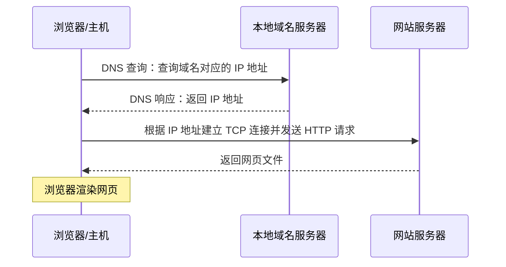
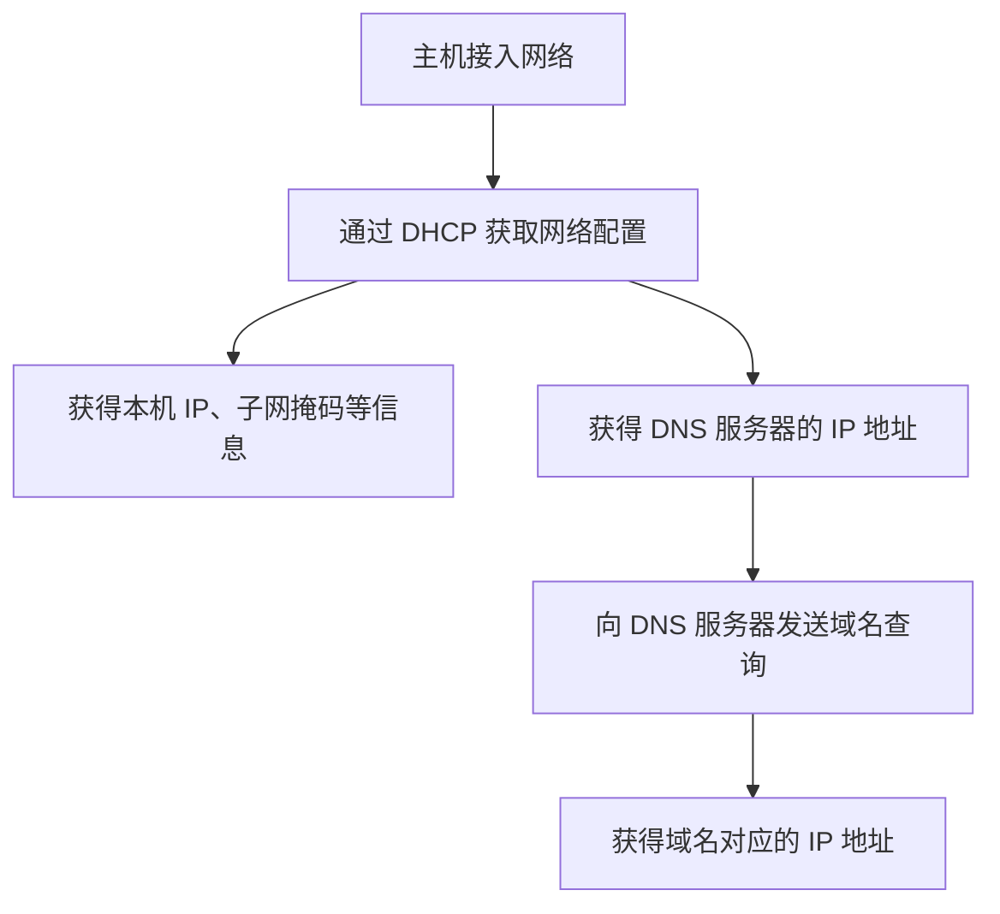
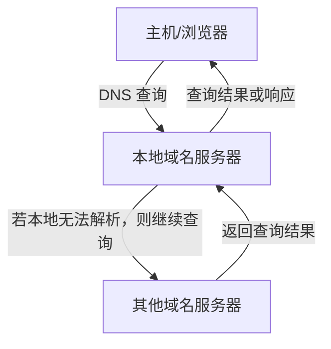
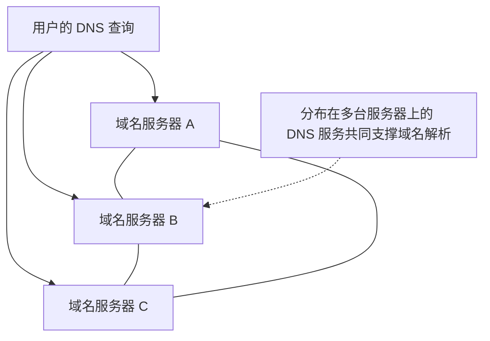

# DNS 域名系统概述

## 一、DNS 的基本概念

### 1. 什么是域名？

DNS 是 **Domain Name System（域名系统）** 的缩写。

域名这个术语并不遥远，平时所说的“网址”通常就包含域名。例如：

| 网站             | 域名示例           |
| ---------------- | ------------------ |
| 百度             | `www.baidu.com`    |
| 哔哩哔哩（B 站） | `www.bilibili.com` |
| 王道论坛         | `www.cskaoyan.com` |

其中，`CS` 是 `Computer Science`（计算机科学）的缩写，`www.cskaoyan.com` 是面向计算机考研的论坛域名。

域名的特点是**便于人类记忆**。

### 2. 域名与主机的关系

当我们在浏览器中访问一个域名时，本质上是在访问这个域名背后对应的网络设备或服务器。

网站服务器本质上也是一台主机，与个人电脑没有本质区别，只是通常性能更强。域名可以用于标识互联网上的某台主机，也可以用于标识路由器等网络设备。

例如：

- 访问 `www.baidu.com`，本质上是访问这个域名对应的服务器。
- 访问 `www.cskaoyan.com`，本质上是访问另一个域名对应的服务器。

可以先记住：

> **域名是给互联网上的主机或路由器取的、便于人类记忆的名字。访问域名，本质上是在访问该域名对应的网络设备或服务。**

### 3. 为什么需要 DNS？

网络中的主机通信需要使用 IP 地址。只知道域名而不知道对应的 IP 地址，主机就无法仅凭域名直接完成后续的网络通信。

DNS 的作用就是：

> **DNS 域名系统可以把便于人类记忆的域名转换成便于计算机处理的 IP 地址。**

例如，用户在浏览器中输入 `www.baidu.com`，主机就会通过 DNS 查询该域名对应的 IP 地址，再使用得到的 IP 地址访问服务器。

#### 类比：人名、身份证号与户籍系统

可以把主机理解为一个人：

| 网络中的概念   | 类比         |
| -------------- | ------------ |
| 主机的域名     | 人名         |
| 主机的 IP 地址 | 身份证号     |
| DNS 域名系统   | 户籍查询系统 |

在户籍系统中输入人名，可以查询对应的身份证号；类似地，在 DNS 中查询域名，可以得到对应的 IP 地址。

## 二、域名的层次结构

### 1. 为什么域名要分层？

如果只使用简单的名字，可能会出现重名问题。例如，全国可能有很多人都叫“咸鱼”，仅凭这个名字无法判断具体指的是谁。

如果名字包含完整的层次化信息，例如“湖北省—武汉市—某村—某人”，就可以降低重名造成的歧义。

DNS 采用了类似的思路：**域名具有层次化结构**，通过不同层级共同标识域名。

### 2. 域名的层级划分

域名使用点号（`.`）分隔层级。通常从右向左理解域名层次，例如：

`www.cskaoyan.com`

| 部分       | 层级示例 | 说明             |
| ---------- | -------- | ---------------- |
| `com`      | 顶级域名 | 位于最右侧       |
| `cskaoyan` | 二级域名 | 位于顶级域名左侧 |
| `www`      | 三级域名 | 位于二级域名左侧 |

域名还可以继续向左增加层级，因此也可能出现四级域名等更细的划分。

> **记忆要点：** 域名具有层次化特性，层次结构有助于组织域名并减少名字冲突。

## 三、DNS 域名解析的基本过程

### 1. 访问网站时发生了什么？

假设用户在浏览器中输入：

`www.baidu.com`

并按下回车键。此时浏览器知道用户想访问哪个域名，但还需要查询该域名对应的 IP 地址。

通常，用户所在的网络服务提供商（ISP）会部署本地域名服务器，也称为 DNS 服务器。域名服务器本身也是一台主机，它保存或能够查询域名与 IP 地址之间的映射信息。

基本过程如下：

1. 浏览器需要访问 `www.baidu.com`。
2. 主机向本地域名服务器发送 DNS 查询，询问该域名对应的 IP 地址。
3. 域名服务器查询后，向主机返回 DNS 响应报文，其中包含查询到的 IP 地址。
4. 浏览器获得 IP 地址后，可以与对应的网站服务器建立 TCP 连接，并发送 HTTP 请求。
5. 网站服务器返回网页文件，浏览器再将网页渲染出来。

#### DNS 查询与网页访问流程图

这里需要区分两个过程：

- **DNS 解析：** 将域名转换为对应的 IP 地址。
- **网页访问：** 浏览器拿到 IP 地址后，再通过相应的网络协议访问网站服务器。

### 2. 主机怎么知道 DNS 服务器的 IP 地址？

主机只有知道 DNS 服务器的 IP 地址，才能向它发送 DNS 查询报文。

通常，主机联网时会通过 **DHCP 协议**自动获取网络配置，例如：

- 本机 IP 地址；
- 子网掩码；
- 默认网关等信息；
- DNS 服务器地址。

因此，DHCP 不仅可以帮助主机自动配置 IP 地址等网络参数，也可以向主机提供本地域名服务器的地址。主机随后就能向该 DNS 服务器发送查询。

## 四、DNS 的基本特点

### 1. DNS 采用客户—服务器（C/S）工作方式

DNS 采用 **Client/Server（C/S，客户—服务器）模型**。

在一次 DNS 查询交互中：

- **DNS 客户端：** 发出 DNS 查询报文的一方；
- **DNS 服务器：** 接收查询并返回 DNS 响应报文的一方。

客户端发出请求，服务器给出响应，这是典型的 C/S 模式。

#### DNS 客户端与服务器的角色是相对的

一台域名服务器如果没有保存某个域名对应的 IP 地址，就可能需要继续向另一台域名服务器发出查询请求。

在这一轮交互中：

- 发出查询的域名服务器扮演 **DNS 客户端**；
- 接收查询并作出响应的域名服务器扮演 **DNS 服务器**。

因此，同一台主机在不同交互中可能扮演不同角色。客户端与服务器是**相对的角色**，并不是一台主机永远只能充当其中一种角色。

### 2. DNS 属于应用层协议，通常使用 UDP 端口 53

DNS 是**应用层协议**，通常基于 UDP 协议传输，使用 **53 号端口**。

当 DNS 客户端发送查询报文时，通常会将 DNS 报文封装在 UDP 数据报中，目的端口号为 `53`。

| 项目               | 典型情况 |
| ------------------ | -------- |
| 所属层次           | 应用层   |
| 常用传输层协议     | UDP      |
| DNS 服务器常用端口 | `53`     |

#### 为什么 DNS 通常使用 UDP？

UDP 是无连接协议，不像 TCP 那样需要先进行三次握手再开始传输数据。

因此，DNS 客户端通常可以直接将查询报文封装在 UDP 数据报中发送出去，不必先建立 TCP 连接。这样可以减少前置开销，提高查询效率。

需要注意，DNS 在某些特殊情况下也可能使用 TCP；现实中也存在基于 HTTP 等方式的 DNS 服务。但对于常见的计算机考研选择题，通常记住 **DNS 基于 UDP、使用 53 号端口**即可。

### 3. DNS 是分布式系统

理解 DNS 的分布式特点，可以先对比分布式系统与集中式系统。

| 对比项         | 集中式系统                   | 分布式系统                               |
| -------------- | ---------------------------- | ---------------------------------------- |
| 数据与服务部署 | 集中在一台或少数几台服务器上 | 分散在多台服务器上                       |
| 工作方式       | 由集中式的设备处理任务       | 多台服务器协同完成任务                   |
| 故障影响       | 核心设备故障可能影响整个系统 | 个别服务器故障通常不至于导致整个系统失效 |
| 设计特点       | 中心化                       | 分布式、去中心化程度更高                 |

可以用“篮子装鸡蛋”来理解：

- **集中式系统：** 把鸡蛋放在同一个篮子里。
- **分布式系统：** 把鸡蛋放在不同的篮子里。

DNS 是非常重要的互联网服务。如果所有数据和服务都集中在少数服务器上，一旦这些服务器发生故障，就可能严重影响域名解析。

DNS 采用分布式设计，将域名数据和解析服务分散到多台服务器上，让它们协同工作。因此，即使个别域名服务器发生故障，也不一定会导致整个 DNS 系统停止工作。

## 五、本节重点总结

### 1. DNS 的作用

DNS 可以把便于人类记忆的域名转换为便于计算机处理的 IP 地址。

| 概念    | 关键含义                                                              |
| ------- | --------------------------------------------------------------------- |
| 域名    | 便于人类记忆的网络设备或服务名称                                      |
| IP 地址 | 网络通信中使用的地址                                                  |
| DNS     | 建立并查询域名与 IP 地址之间的映射关系                                |
| DHCP    | 主机联网时可用于自动获取 IP、子网掩码、默认网关、DNS 服务器地址等配置 |

### 2. DNS 的三个基本特点

| 特点       | 需要记住的内容                                            |
| ---------- | --------------------------------------------------------- |
| 工作模型   | C/S（客户—服务器）模型，客户端发出请求，服务器返回响应    |
| 协议与端口 | 属于应用层协议，通常使用 UDP，服务器端口号为 `53`         |
| 系统结构   | 分布式系统，个别域名服务器故障通常不会使整个 DNS 系统失效 |

### 3. 一句话记忆

> **DNS 是应用层的分布式系统，采用 C/S 工作方式，通常基于 UDP 的 53 号端口，将域名解析为 IP 地址。**

王道论坛的域名示例：`www.cskaoyan.com`。
