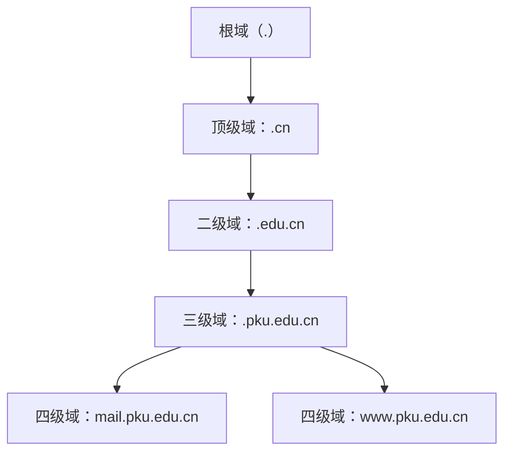
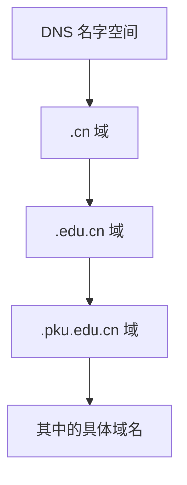
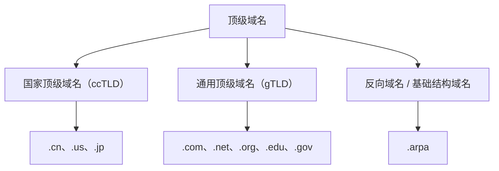
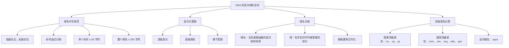

# DNS 的层次域名空间

> 计算机考研 408 · 计算机网络 · 应用层  
> 本节重点：域名书写规范、DNS 层次化管理、域名与域的概念、顶级域名分类。

---

## 一、层次域名的书写规范

### 1. 域名是分层次书写的

一个完整的域名由多个部分组成，各部分之间使用英文句点 `.` 分隔。

例如：

```text
www.cskaoyan.com
```

从右往左看，域名的层次由高到低：

| 部分       | 层级     | 说明             |
| ---------- | -------- | ---------------- |
| `com`      | 顶级域名 | 最右侧的部分     |
| `cskaoyan` | 二级域名 | 位于顶级域名左侧 |
| `www`      | 三级域名 | 位于二级域名左侧 |

**书写规则：低级域名在左，高级域名在右。** 从右往左，依次是顶级域名、二级域名、三级域名……

另一个例子：

```text
mail.pku.edu.cn
```

从右往左依次为：

1. `cn`：顶级域名
2. `edu`：二级域名
3. `pku`：三级域名
4. `mail`：四级域名

因此，一个域名可以有多个层级。

### 2. 标号（label）

域名中由句点分隔的每一部分称为一个**标号**。

例如：

```text
www.cskaoyan.com
```

这个域名由三个标号组成：

- `www`
- `cskaoyan`
- `com`

再如：

```text
mail.pku.edu.cn
```

这个域名由四个标号组成。谈论标号时，通常只讨论各个部分本身，不特意强调它属于第几级。

### 3. 标号的组成规则

按照本节课程及教材的常见表述，标号主要由英文字母、数字和连字符组成。

#### （1）英文字母不区分大小写

例如，下面两种写法在域名意义上等价：

```text
www.cskaoyan.com
www.CSKAOYAN.com
```

域名中的英文字母不区分大小写，因此大小写不同通常不会导致访问不同的域名。

#### （2）标号可以由数字组成

例如：

```text
www.4399.com
```

中间的标号 `4399` 由数字组成。

标号也可以是英文字母和数字的组合。

#### （3）标号中可以包含连字符

例如：

```text
www.cs-kaoyan.com
```

其中的连字符 `-` 是允许的。

但加号等其他标点符号不符合这里介绍的常见域名标号规则。例如：

```text
www.cs+kaoyan.com
```

按照教材中介绍的规则，这种写法不合法。

#### （4）标号和整个域名的长度限制

| 限制对象 | 长度限制                                  |
| -------- | ----------------------------------------- |
| 单个标号 | 不超过 63 个字符                          |
| 整个域名 | 包含各部分之间的点在内，不超过 255 个字符 |

每个英文字母、数字或连字符都占用一个字符。

DNS 相关协议没有对域名级数规定一个固定的统一上限。因此，域名理论上可以有很多级；需要满足的是单个标号以及整个域名的长度限制。

### 4. 关于中文域名的补充

早期教材通常将域名标号描述为主要由英文字母、数字和连字符组成。现实中的国际化域名技术允许域名包含中文等非 ASCII 字符。

**考试时应以指定教材和考纲的表述为准；理解现实应用时，则需要知道中文域名确实存在。**

### 5. 域名书写规则速记

```text
低级域名在左，高级域名在右
标号之间用英文句点 . 分隔
英文字母不区分大小写
标号主要由字母、数字、连字符组成
单个标号长度 ≤ 63 个字符
整个域名长度（包含点）≤ 255 个字符
域名级数没有固定的统一上限
```

> **考点提示：** 域名书写规则可能以选择题形式考查，尤其要注意标号允许的字符，以及单个标号和整个域名的长度限制。

---

## 二、DNS 为什么采用层次化的域名空间？

域名采用层次结构，重要目的之一是**便于域名的分级授权和管理**。

如果所有域名都由一个机构统一管理，域名数量不断增长时，管理和维护就会变得复杂。层次化结构可以将管理权限逐级向下授权，让不同管理机构负责相应层级的域名。

### 1. 域名的逐级管理与授权

域名空间的管理可以理解为逐层划分：

1. 根域之下划分出多个顶级域。
2. 顶级域之下可以进一步划分二级域。
3. 二级域之下可以继续划分三级域。
4. 获得某一级域名管理权限的机构，可以按照授权规则管理其下级域名。

例如，国内高校常见的域名会以 `edu.cn` 结尾，这体现了域名空间的层次结构。



上图用于理解域名层次：域名可以逐级划分，相关管理权限也可以逐级授权。

### 2. 以 `.cn` 域名为例

按照课程中的讲解思路：

- ICANN 负责协调 DNS 的全球唯一标识符系统，并决定、协调顶级域名体系中的相关事项。
- `.cn` 是中国的国家顶级域名，其下的域名管理由相应的国家级域名注册管理机构负责。
- `.cn` 之下可以有 `.edu.cn`、`.com.cn` 等二级域名。
- `.edu.cn` 之下还可以继续划分具体机构使用的域名。
- 北京大学获得 `pku.edu.cn` 这样的域名后，可以进一步安排其下的主机名称，例如：
  - `www.pku.edu.cn`
  - `mail.pku.edu.cn`

其他高校也可以按授权规则管理自己的域名及其下级名称。

### 3. 以 `.com` 域名为例

对于 `.com` 这样的通用顶级域名，组织或企业可以注册相应的二级域名。例如：

| 示例域名           | 层级示例              |
| ------------------ | --------------------- |
| `baidu.com`        | `baidu` 是二级域名    |
| `qq.com`           | `qq` 是二级域名       |
| `cskaoyan.com`     | `cskaoyan` 是二级域名 |
| `www.cskaoyan.com` | `www` 是三级域名      |

取得相应域名后，机构通常可以依据注册协议和管理规则配置其下级域名。例如，可以将 `www.cskaoyan.com` 分配给网站服务器使用。

域名本质上是主机或路由器的层次结构名称。它让人们能够使用相对容易记忆的名称，而不必在日常访问时直接记住 IP 地址。

### 4. 层次化结构的核心好处

- **分级管理：** 不同机构负责不同层次的域名。
- **逐级授权：** 上级管理机构可以把部分管理权限授权给下级机构。
- **便于扩展：** 下级机构可以在获得授权的范围内继续划分和管理域名。
- **便于组织：** 域名结构可以体现组织、类别或管理范围等层次关系。

> **核心结论：DNS 域名空间采用层次化结构，便于域名的分级授权和管理。**

---

## 三、域名与域

### 1. 域名（Domain Name）

**域名是主机或者路由器的层次结构名称。**

例如：

```text
www.cskaoyan.com
```

该名称具有层次结构：

- `com`：顶级域名
- `cskaoyan`：二级域名
- `www`：三级域名

#### 根域名与最后的点

在顶级域名之上，还有一个**根域**。根域通常用一个点 `.` 表示。

严格来说，完整域名可以在最后再加一个点来表示根域。例如：

```text
www.cskaoyan.com.
```

其中最后的 `.` 对应根域。在日常访问和书写时，这个最后的点通常被省略，所以一般写成：

```text
www.cskaoyan.com
```

示意结构如下：

```text
根域 .
└── com
    └── cskaoyan
        └── www
```

### 2. 域（Domain）

**域是名字空间中可被管理的一个划分。**

这个定义不太直观，可以借助集合的思想理解：

- **域名**可以理解为某个名字。
- **域**可以理解为名字空间中一块可被管理的范围，其中可以包含下级域。

例如：

- `.cn` 是一个顶级域。
- `.edu.cn` 可以理解为 `.cn` 之下的一个下级域。
- `.pku.edu.cn` 又是进一步划分出的下级域。

可以用集合关系帮助理解：



这里的图是为了帮助理解域之间的层次和包含关系，并不表示域名解析时只会沿着图中这一条路径进行。

**理解重点：域强调可管理的名字空间范围；域名强调主机或路由器的层次结构名称。** 对本节学习而言，能够区分两者的大致含义即可，不必过度纠结于定义措辞。

---

## 四、顶级域名的分类

根域下面可以划分出多个顶级域名。课程将顶级域名分为三类：

1. 国家顶级域名
2. 通用顶级域名
3. 反向域名（基础结构域名）



### 1. 国家顶级域名（ccTLD）

英文缩写：**ccTLD**，来自 _country code top-level domain_。

国家顶级域名通常与国家或地区对应，例如：

| 国家或地区 | 国家顶级域名 |
| ---------- | ------------ |
| 中国       | `.cn`        |
| 美国       | `.us`        |
| 日本       | `.jp`        |

国家顶级域名通常授权给相应国家或地区的管理机构管理。

### 2. 通用顶级域名（gTLD）

英文缩写：**gTLD**，来自 _generic top-level domain_。

常见通用顶级域名如下。

| 顶级域名 | 英文含义     | 课程中的常见用途或例子       |
| -------- | ------------ | ---------------------------- |
| `.com`   | commercial   | 通常用于商业组织或公司       |
| `.net`   | network      | 常见于网络服务相关机构或平台 |
| `.org`   | organization | 常见于组织，尤其是非营利组织 |
| `.edu`   | education    | 课程中介绍为美国教育机构使用 |
| `.gov`   | government   | 课程中介绍为美国政府机构使用 |

#### （1）`.com`

`com` 是 _commercial_ 的缩写，通常用于商业组织或公司。

示例：

```text
baidu.com
qq.com
cskaoyan.com
```

#### （2）`.net`

`net` 来自 _network_，常见于提供互联网或网络服务的机构、平台。

课程中的例子包括：

```text
battle.net
netflix.net
```

#### （3）`.org`

`org` 是 _organization_ 的缩写，常见于各类组织，尤其是非营利性组织。

课程中提到的例子包括：

```text
wto.org
un.org
```

维基百科等组织也常被用来举例说明 `.org` 的使用情形。

#### （4）`.edu` 和 `.gov`

课程强调，`.edu` 和 `.gov` 虽属于通用顶级域名，但其传统使用范围主要与美国教育机构和政府机构相关，因此在中国的网站中相对少见。

课程中的示例：

```text
www.harvard.edu
www.usa.gov
```

> **复习提醒：** 以上是本节课程用于记忆的典型对应关系。实际域名的注册和使用资格应以相应顶级域的注册政策为准。

### 3. 反向域名（基础结构域名）

反向域名也称为**基础结构域名**。课程介绍的这类顶级域名只有一个：

```text
.arpa
```

它可以用于**反向域名解析**，即根据 IP 地址查询对应的域名。

#### 正向解析与反向解析

| 解析方向 | 输入    | 查询目标       |
| -------- | ------- | -------------- |
| 正向解析 | 域名    | 对应的 IP 地址 |
| 反向解析 | IP 地址 | 对应的域名信息 |

例如，查询 IP 地址 `8.8.8.8` 的反向 DNS 名称时，可以使用类似下面的名称：

```text
8.8.8.8.in-addr.arpa
```

对于 IPv4 反向解析，通常使用 `in-addr.arpa` 域下的反向映射名称。实际查询需要使用支持 DNS 查询的网络工具；直接在普通浏览器地址栏中输入它，并不是常规的反向 DNS 查询方法。

> **考点提示：** `.arpa` 的主要用途之一是反向域名解析，可能作为选择题中的考查点。

---

## 五、本节知识结构总览



### 考前速记

- **书写方向：** 低级域名在左，高级域名在右；从右往左层级逐渐降低。
- **标号：** 域名中由点分隔的每一部分称为标号。
- **大小写：** 域名中的英文字母不区分大小写。
- **长度：** 单个标号不超过 63 个字符，整个域名（包含点）不超过 255 个字符。
- **级数：** 域名级数没有固定的统一上限。
- **层次化的好处：** 便于域名的分级授权和管理。
- **域名：** 主机或路由器的层次结构名称。
- **域：** 名字空间中可被管理的划分。
- **根域：** 通常用 `.` 表示；完整域名末尾的点在日常书写中通常省略。
- **顶级域名分类：** 国家顶级域名、通用顶级域名、反向域名。
- **反向域名：** `.arpa`，可用于反向域名解析。
