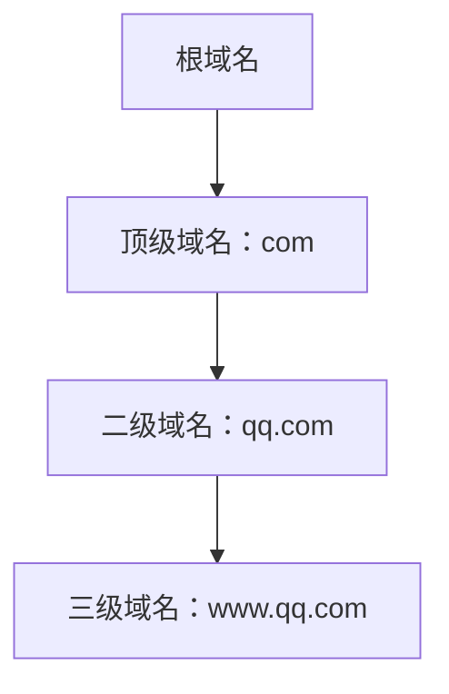
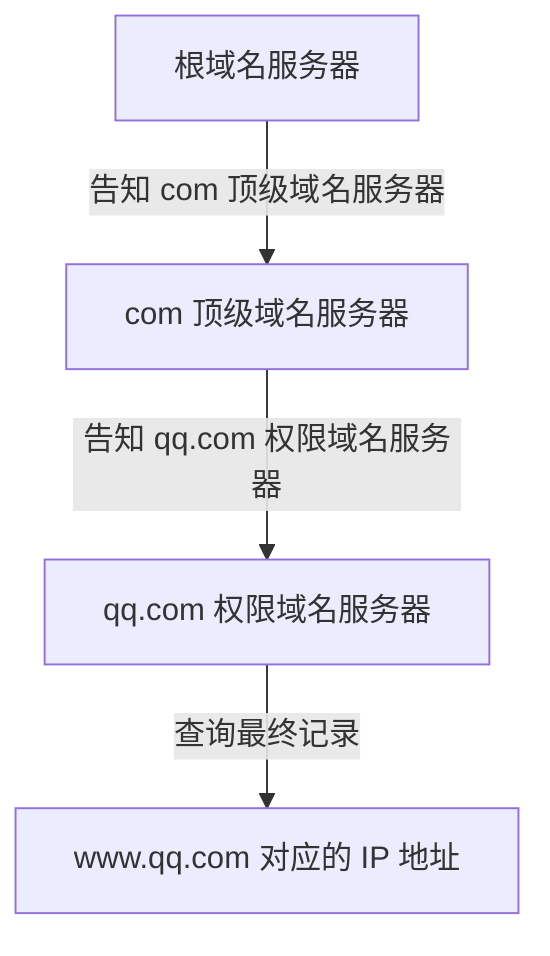
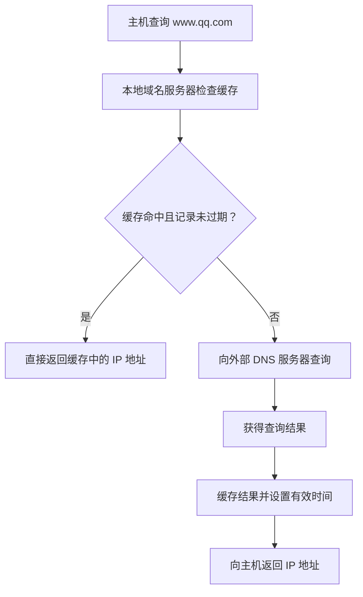
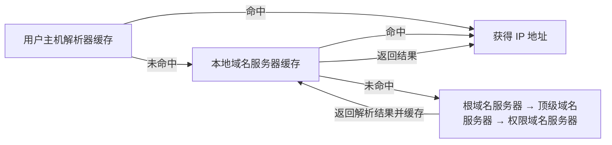
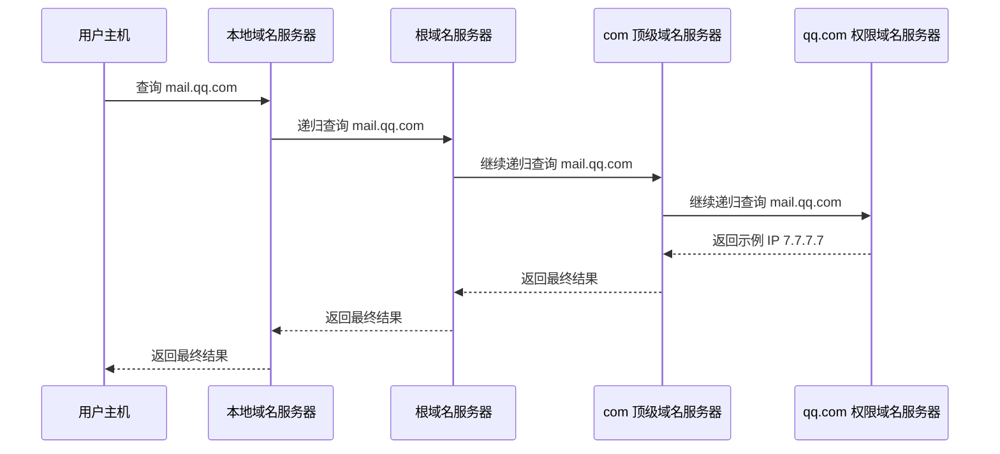
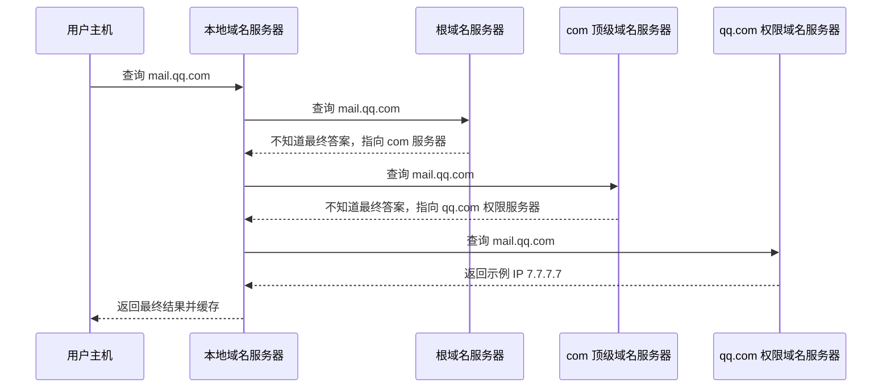
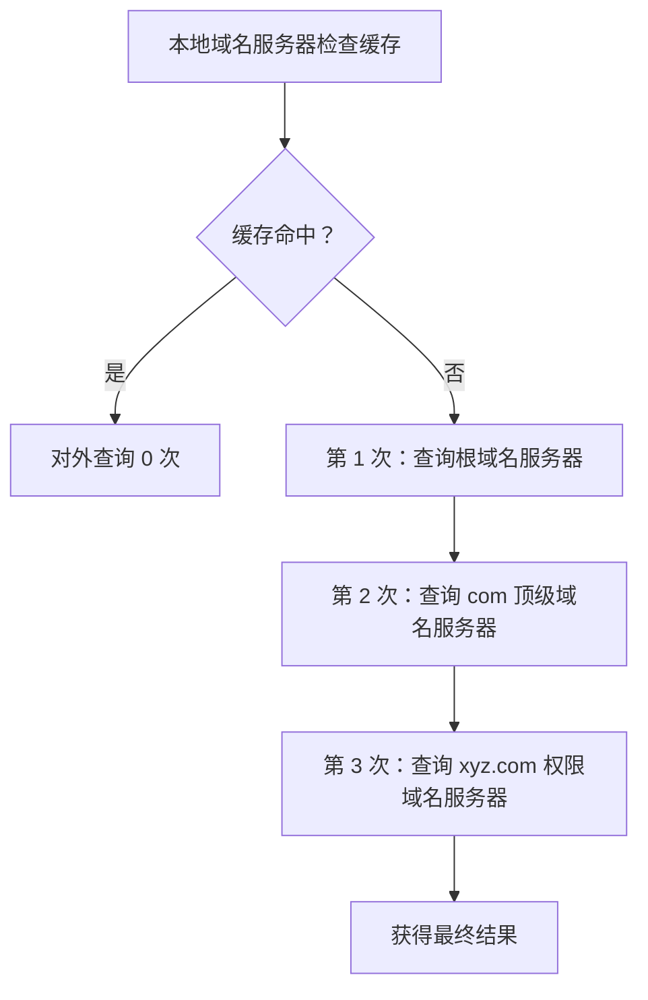

# DNS 域名解析：域名服务器分类、DNS 缓存与查询方式

> 408 计算机网络学习笔记  
> 本笔记在保留原讲解知识点、示例与结论的基础上，调整了标题层级、排版和表达形式，并补充了便于复习的 Markdown 图示。

## 一、域名解析的基本概念

### 1. 什么是域名解析？

**域名解析（Domain Name Resolution）**，就是把域名转换成对应 IP 地址的过程。DNS（Domain Name System，域名系统）通过 DNS 查询完成这一过程。

例如，要访问：

```text
www.qq.com
```

主机需要通过 DNS 查询获得该域名对应的 IP 地址，之后才能根据 IP 地址与目标主机通信。

### 2. 域名具有层次结构

域名从右向左体现层次关系。例如：

```text
www.qq.com
│   │  │
│   │  └── 顶级域名：com
│   └───── 二级域名：qq
└───────── 三级域名：www
```

从根域名开始，域名空间按层次组织成树状结构。域名解析要利用这种层次结构，逐步找到相应的域名服务器，最终取得目标主机的 IP 地址。



## 二、为什么不能采用集中式 DNS？

一种看起来简单的办法，是部署一台“超级域名服务器”，将全世界所有域名及其对应 IP 地址的映射关系都存储在这台服务器中。所有计算机查询域名时，都向这台服务器发送 DNS 查询请求。为了让全球计算机都能找到它，可以给它分配一个固定 IP 地址。

这种方式属于**集中式 DNS 系统**，但现实中不可行，主要有以下三个问题。

### 1. 存储量大，检索速度慢

全球域名数量非常庞大，域名与 IP 地址的映射信息很多。如果所有信息都集中在一台服务器上：

- 服务器需要承担很大的存储负担；
- 由于需要管理、检索的信息量很大，查询效率也会受到影响。

### 2. 单点故障，抗风险能力弱

如果唯一的超级域名服务器损坏或宕机，全球 DNS 查询服务都可能受到严重影响。即使用户知道某个网站的域名，也可能无法正常完成域名解析。

这就是典型的**单点故障**问题。

### 3. 查询量过大，单台服务器难以承担

原课程中引用的数据是：全球 DNS 查询请求每秒大约有 **1,500 万次**，高峰期可能达到数千万次。若所有查询都由一台服务器处理，服务器很难承担如此巨大的请求量。

因此，DNS 需要采用分层、分布式的体系结构，并通过多台服务器与缓存机制分担负载。

## 三、四类域名服务器

DNS 中常见的四类域名服务器是：

1. 根域名服务器（Root Name Server）
2. 顶级域名服务器（Top-Level Domain Server）
3. 权限域名服务器（Authoritative Name Server）
4. 本地域名服务器（Local DNS Server）

前三类服务器构成域名层次查询中的主要层级；本地域名服务器则通常作为用户侧的 DNS 查询入口，并通过缓存降低外部查询量。

### 1. 根域名服务器

根域名服务器位于域名层次的顶端。

它通常不直接保存全球所有终端主机的域名与 IP 地址映射，而是保存各个**顶级域名服务器的相关信息**。当根域名服务器收到一个域名查询时，可以根据域名的顶级域名判断下一步应查询哪一台顶级域名服务器。

例如，查询 `www.qq.com` 时：

- 根域名服务器识别出顶级域名是 `com`；
- 然后告知查询方应向 `com` 顶级域名服务器继续查询。

根域名服务器因此不必保存每一台终端主机的 IP 地址信息，存储与检索负担比“超级域名服务器”小得多。

### 2. 顶级域名服务器

顶级域名服务器负责相应顶级域名之下的下一层查询线索，维护其所管理范围内的权限域名服务器信息。

例如，查询 `www.qq.com`：

1. 根域名服务器识别出顶级域名为 `com`；
2. 查询方转向 `com` 顶级域名服务器；
3. `com` 顶级域名服务器根据二级域名 `qq`，告知查询方下一步应询问 `qq.com` 对应的权限域名服务器。

顶级域名服务器并不需要保存所有终端主机的最终 IP 地址，而是帮助查询逐层接近目标域名所在的权限域。

### 3. 权限域名服务器

权限域名服务器（也称权威域名服务器）负责其权限范围内的域名信息，可以保存相应域名及主机 IP 地址的映射关系。

例如，`qq.com` 对应的权限域名服务器可以保存：

- `www.qq.com` 对应的 IP 地址；
- 该域名管理范围内其他主机的域名与 IP 地址映射。

类似地，`cskaoyan.com` 对应的权限域名服务器可以保存 `www.cskaoyan.com`、`home.cskaoyan.com` 等主机的映射信息。

再例如，`edu.cn` 对应的权限域名服务器可能保存以 `edu.cn` 结尾的域名信息，包括 `www.pku.edu.cn` 这样的更深层次域名所对应的信息。

当查询到达能够回答该域名的权限域名服务器时，就可以获得最终的查询结果，再将结果返回给查询方。

### 4. 三层域名服务器如何配合？

以 `www.qq.com` 为例，查询线索逐层向下：



通过根域名服务器、顶级域名服务器和权限域名服务器逐层配合，DNS 可以利用域名的层次结构定位最终答案，而不必把全球全部域名映射集中存放在一台服务器中。

### 5. 根域名服务器为何有 13 组？

如果全世界只有一台根域名服务器，那么它一旦损坏，DNS 查询就会面临严重的单点故障风险。

现实中，全球部署了 **13 组逻辑上的根域名服务器**。每组根域名服务器都具备相应的根区信息，可以提供各顶级域名服务器的相关信息。

需要区分的是：**13 组并不意味着全球物理上只有 13 台机器。** 一组根域名服务背后可以对应多台分布在不同地点的服务器实例。

### 6. 任播（Anycast）技术

根域名服务会利用**任播（Anycast）**等方式，让多个分布在不同地区的服务器实例共享同一个服务 IP 地址。用户向该 IP 地址发送请求时，网络路由通常会将请求转发到一个较合适、通常较近的服务实例。

例如，同一组根域名服务的实例可能部署在亚洲、非洲、澳洲、北美和南美等不同地区：

- 亚洲用户的请求可以被路由到亚洲的实例；
- 南美用户的请求可以被路由到南美附近的实例；
- 如果某个实例发生故障，网络也可能将请求引导到其他可用实例。

任播有助于提高访问效率，并增强冗余与容灾能力。可以把它类比为在不同位置安排多名服务员：顾客发出请求后，由网络将请求交给其中一个合适的服务实例处理。

> **理解重点：** 13 组是根域名服务器的逻辑体系；每组背后可以有许多物理实例。不能把“13 组”理解成“全球只有 13 台根服务器机器”。

### 7. 本地域名服务器

本地域名服务器（Local DNS Server）是用户侧常用的 DNS 查询入口，数量非常多，通常由网络服务提供商、学校或大型企业部署。

例如：

- 中国电信、中国移动等 ISP 会在不同地区部署本地域名服务器；
- 高校可能为校内网络部署本地域名服务器；
- 大型企业也可能在内部部署本地域名服务器。

本地域名服务器通常为用户就近提供 DNS 解析服务。

主机接入网络时，常会通过 DHCP 等机制获得网络配置信息，其中可以包括本地域名服务器的 IP 地址。之后，主机便可向配置好的本地域名服务器发出 DNS 查询。

本地域名服务器还有一个重要功能：**DNS 缓存**。即使某次查询需要向外部域名服务器逐层查询，查询结果也可以暂时缓存下来，以便后续请求直接使用。

## 四、DNS 缓存：减少重复查询

### 1. 本地域名服务器的缓存

假设本地域名服务器刚启动时，DNS 缓存为空。用户查询 `www.qq.com`：

1. 本地域名服务器先检查缓存；
2. 如果没有对应记录，就向外部域名服务器发起查询；
3. 查询逐层进行，最终由相应的权限域名服务器给出 IP 地址；
4. 本地域名服务器获得结果后，将域名与 IP 地址信息缓存下来，并设置有效时间；
5. 本地域名服务器把查询结果返回给用户主机。

假设该示例中的结果是 `www.qq.com → 6.6.6.6`，缓存有效时间为 30 分钟。

当另一台主机随后查询同一个域名时，如果本地域名服务器中的记录仍然有效，就可以直接返回缓存结果，不必重新访问根域名服务器及后续服务器。



现实中，大量用户会反复查询热门域名。热门域名更容易被缓存命中，从而避免重复的外部查询，显著降低根域名服务器及其他上级域名服务器所承受的压力。

### 2. TTL 与缓存有效时间

缓存记录通常带有有效时间。讲解中以 **30 分钟**作为示例。

在记录有效时间内，缓存可以被使用；过期后，缓存记录不能再简单地被当作仍然有效的最新结果使用，需要根据 DNS 的缓存规则重新获取或验证相关信息。

**TTL（Time To Live，生存时间）**是理解 DNS 缓存有效期时需要掌握的概念。

### 3. 主机内部的解析器与缓存

除了本地域名服务器，终端主机内部也可能保存 DNS 缓存。

**解析器（Resolver）**是负责发出 DNS 查询报文、接收并解析 DNS 响应报文的程序。

通常，操作系统会提供系统级解析器。应用程序需要进行域名查询时，可以调用操作系统提供的解析器，而不必自行实现整套 DNS 查询逻辑。

有些对 DNS 使用频率较高的应用（例如浏览器）也可能在应用内部实现自己的 DNS 解析逻辑，因此可以不完全依赖操作系统解析器的查询路径。

所以，在讲解中说“浏览器向本地域名服务器发出 DNS 查询报文”，或者概括地说“一台主机向域名服务器发出 DNS 查询报文”，都可能是在不同抽象层次下进行描述。主机内部通常会有系统级解析器，而某些应用也可能拥有自己的解析器或缓存机制。

解析器内部同样可以保存 DNS 缓存。例如，主机最近查询过 `www.qq.com`，并缓存了示例地址 `6.6.6.6`，且缓存尚未过期，那么再次访问时就可能直接使用本机缓存，不必向本地域名服务器发出新的 DNS 查询。

### 4. 两层缓存的作用要区分

| 缓存位置           | 主要作用                                         | 缓存命中后的效果                   |
| ------------------ | ------------------------------------------------ | ---------------------------------- |
| 主机解析器缓存     | 减少终端主机向本地域名服务器发出 DNS 查询的频率  | 主机可直接使用缓存结果             |
| 本地域名服务器缓存 | 减少本地域名服务器向外部域名服务器发出查询的频率 | 本地域名服务器可直接向用户返回结果 |



通过全球大量的本地域名服务器以及主机、服务器侧的 DNS 缓存，即使全球 DNS 查询总量很大，根域名服务器也不需要处理每一次用户查询。大量重复查询可以在更靠近用户的位置得到处理。

## 五、DNS 查询方式：递归查询与迭代查询

域名解析通过 DNS 查询完成。常见的查询方式有两种：

- **递归查询（Recursive Query）**
- **迭代查询（Iterative Query）**

两者最核心的区别是：当被询问的一方不知道最终答案时，它接下来做什么。

| 比较点               | 递归查询                                               | 迭代查询                                 |
| -------------------- | ------------------------------------------------------ | ---------------------------------------- |
| 对方不知道最终答案时 | 如果支持递归服务，就继续替请求方查询，尽力取得最终答案 | 告诉请求方下一步应向哪台服务器查询       |
| 请求方的体验         | 等待对方直接返回最终结果                               | 根据对方提供的线索，再向下一台服务器查询 |
| 形象理解             | “我不知道，但我帮你查到答案再告诉你”                   | “我不知道，你接下来去问这台服务器”       |

### 1. 递归查询

递归查询可以理解为：你向我提出问题，即使我不知道最终答案，只要我支持递归查询，就会继续想办法取得最终答案，再把答案返回给你。

以主机查询 `mail.qq.com` 为例。假设：

- 主机向本地域名服务器查询；
- 本地域名服务器缓存未命中；
- 为便于说明，假设接下来各被询问的服务器都支持递归查询；
- 最终权限域名服务器找到的示例 IP 地址是 `7.7.7.7`。

递归查询过程如下：



这个示意强调的是递归查询的逻辑：下层服务器找到结果后，结果沿着调用链逐层返回。它类似于函数调用：

```text
A 调用 B
  B 调用 C
    C 调用 D
    D 返回结果给 C
  C 返回结果给 B
A 获得最终结果
```

**注意：**上图是为了说明递归查询的工作方式而作的概念性示意。实际 DNS 部署中，根域名服务器通常提供的是迭代式应答（返回下一步查询线索），并不替本地域名服务器递归查询整个域名解析过程。具体查询方式还取决于服务器是否提供相应服务。

### 2. 迭代查询

迭代查询可以理解为：你问我一个问题，如果我不知道最终答案，我会告诉你下一步应该问谁，而不是替你把整个问题查到底。

继续以主机查询 `mail.qq.com` 为例。假设本地域名服务器的缓存没有命中，查询采用迭代方式：

1. 主机向本地域名服务器查询 `mail.qq.com`；
2. 本地域名服务器向根域名服务器查询；
3. 根域名服务器不知道最终 IP 地址，于是告诉本地域名服务器下一步去询问 `com` 顶级域名服务器；
4. 本地域名服务器向 `com` 顶级域名服务器查询；
5. `com` 顶级域名服务器告知下一步应询问 `qq.com` 权限域名服务器；
6. 本地域名服务器向 `qq.com` 权限域名服务器查询；
7. 权限域名服务器返回最终的示例 IP 地址 `7.7.7.7`；
8. 本地域名服务器缓存查询结果，并将结果返回给主机。



在迭代查询过程中，**本地域名服务器负责依照收到的线索继续向下一台服务器查询**。根域名服务器和顶级域名服务器只需提供下一步查询线索，而不必替本地域名服务器继续完成全部查询。

### 3. 递归与迭代的几个考试要点

- 查询报文中可以指明请求采用哪种查询方式，但最终能否使用该方式，还取决于接收查询的服务器是否提供相应服务。
- 现实中，根域名服务器通常提供迭代式应答。
- 常见教学示意中，终端主机向本地域名服务器发出的查询通常按递归查询来理解：主机希望本地域名服务器直接返回最终答案。
- 本地域名服务器向外部域名服务器查询时，可以采用迭代查询。此时它会依次询问根域名服务器、顶级域名服务器以及相应的权限域名服务器。
- 做题时应以题目明确给出的查询方式为准，不能只根据一般情形判断。

## 六、真题与改编题分析

### 1. 2010 年第 40 题：递归解析时的查询报文数量

**题意：**如果本地域名服务器没有缓存，当采用递归的方法解析另一个网络中某主机的域名时，用户主机和本地域名服务器发送的域名请求消息数分别是多少？

**结论：选 A。用户主机发送 1 次，本地域名服务器发送 1 次。**

#### 分析

1. 用户主机首先向本地域名服务器发送一次 DNS 查询请求。
2. 本地域名服务器缓存未命中，因此向根域名服务器发送一次递归查询请求。
3. 在题目假设的递归查询模型中，根域名服务器继续向顶级域名服务器查询，顶级域名服务器再向权限域名服务器查询。
4. 最终结果沿原路径返回，直至本地域名服务器把结果返回给用户主机。

从用户主机的角度，它只向本地域名服务器发出一次 DNS 查询。从本地域名服务器的角度，它向外部发出一次查询请求；其余层级的查询由递归链中的其他服务器继续完成。

#### 如果本地域名服务器向外部采用迭代查询呢？

若改为本地域名服务器对外采用迭代查询，那么它需要依次询问根域名服务器、顶级域名服务器和权限域名服务器，因此会发出多次 DNS 查询请求，而不再只有一次。

**审题关键：**递归查询和迭代查询的请求报文数量可能不同。

### 2. 2016 年第 40 题改编：迭代查询时的最少与最多次数

**题意：**假设所有域名服务器都采用迭代查询。当主机 H4 访问 `www.xyz.com` 时，本地域名服务器在完成域名解析的过程中，可能发出的 DNS 查询次数最少和最多分别是多少？

**结论：选 A，最少 0 次，最多 3 次。**

这里统计的是**本地域名服务器向外部域名服务器发出的查询次数**，不是主机向本地域名服务器发出的次数。

#### 最少次数：0 次

如果本地域名服务器的缓存命中，并且缓存记录仍然有效，那么它可以直接把结果返回给主机，无须向外部域名服务器发出查询。

因此，本地域名服务器对外查询的最少次数是 **0 次**。

#### 最多次数：3 次

如果本地域名服务器缓存未命中，并且需要通过迭代查询取得结果：

1. 向根域名服务器查询 `www.xyz.com`；
2. 根域名服务器指向 `com` 顶级域名服务器，本地域名服务器再向 `com` 查询；
3. `com` 顶级域名服务器指向 `xyz.com` 对应的权限域名服务器，本地域名服务器再向其查询，取得最终结果。

因此，本地域名服务器最多发出 **3 次 DNS 查询**。



## 七、复习总结

### 1. 四类域名服务器的分工

| 类型           | 核心作用                                                             |
| -------------- | -------------------------------------------------------------------- |
| 根域名服务器   | 提供顶级域名服务器的相关信息，指引查询进入正确的顶级域               |
| 顶级域名服务器 | 提供其管理范围内相关权限域名服务器的信息                             |
| 权限域名服务器 | 保存其权限范围内的域名记录，能够回答相应域名的查询                   |
| 本地域名服务器 | 作为用户侧常用的查询入口，为用户提供解析服务，并通过缓存减少外部查询 |

### 2. DNS 缓存的作用

- **主机解析器缓存：**降低终端主机向本地域名服务器发出 DNS 查询请求的频率。
- **本地域名服务器缓存：**降低本地域名服务器向外部域名服务器发出查询请求的频率。
- 缓存记录有有效时间；只有记录仍有效时，才能直接按缓存结果处理查询。

### 3. 递归查询与迭代查询

| 记忆角度         | 递归查询                                     | 迭代查询                                                     |
| ---------------- | -------------------------------------------- | ------------------------------------------------------------ |
| 不知道答案怎么办 | 若支持递归服务，则继续替请求方查找最终答案   | 告诉请求方下一步应查询哪台服务器                             |
| 谁继续查询       | 被请求且提供递归服务的服务器继续查询         | 原请求方根据线索继续查询                                     |
| 报文数量题       | 不能简单把所有层级的查询都算作请求方自己发出 | 本地域名服务器可能依次向根、顶级、权限域名服务器发出多个请求 |

### 4. 做题检查清单

- [ ] 题目统计的是用户主机的请求数，还是本地域名服务器向外部发出的请求数？
- [ ] 本地域名服务器缓存是否命中？
- [ ] 题目明确采用递归查询还是迭代查询？
- [ ] 被请求的服务器是否支持题目所假设的查询方式？
- [ ] “最少次数”是否可以由缓存命中实现？
- [ ] “最多次数”需要经过多少层外部域名服务器？

**本节核心：**DNS 利用分层的域名服务器体系定位域名信息，以任播等部署方式增强根域名服务的可用性，再通过主机解析器和本地域名服务器的缓存减少重复查询。递归查询强调“替请求方查到最终答案”，迭代查询强调“告诉请求方下一步问谁”。做题时要特别注意查询方式与统计对象。
