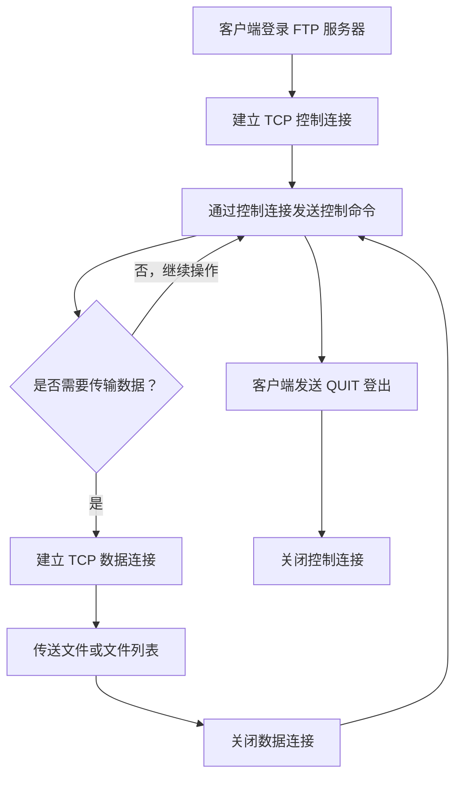
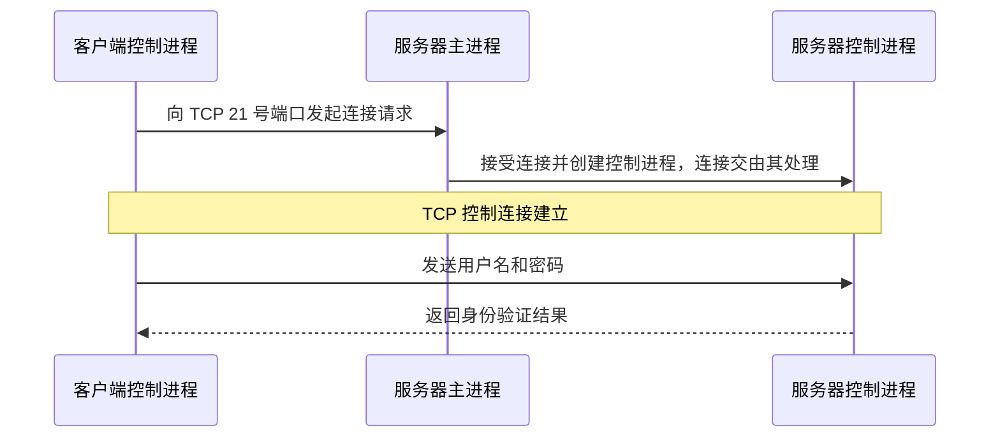
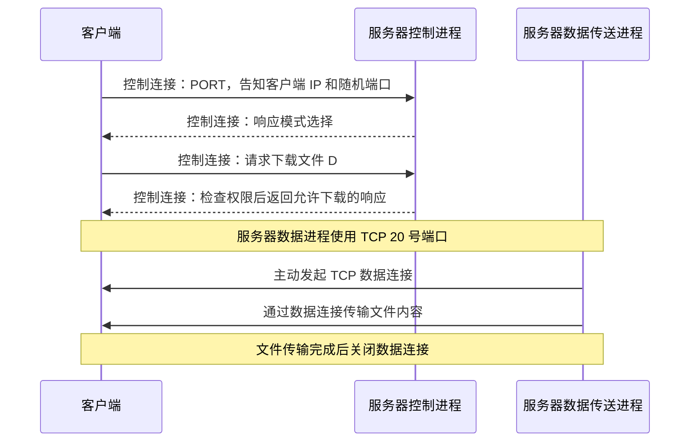
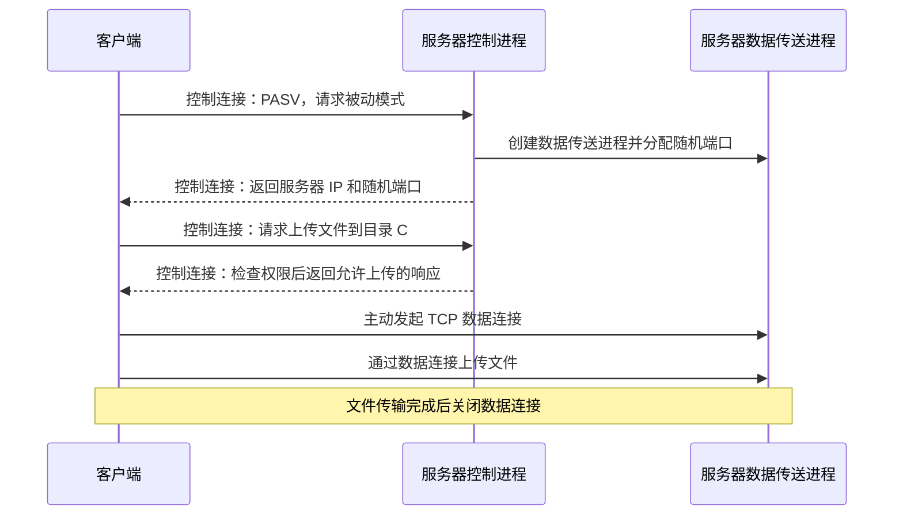
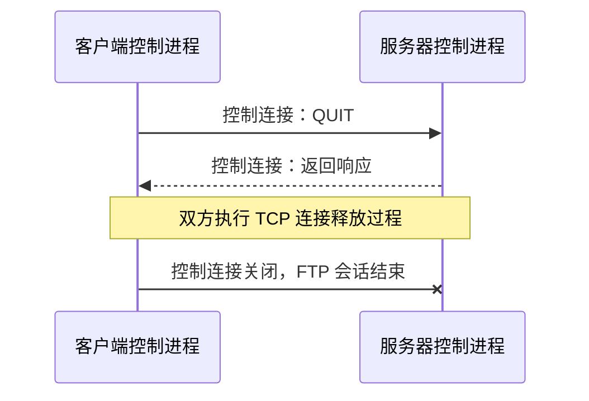
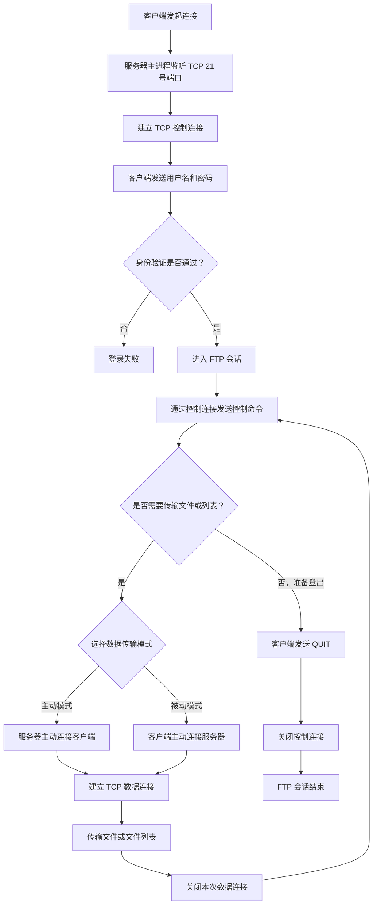

# FTP 文件传输协议（408 计算机网络）

## 一、FTP 概述

### 1. FTP 的背景与用途

FTP（**File Transfer Protocol，文件传输协议**）是一种应用层协议，诞生于 20 世纪 70 年代初。随着 20 世纪 80 年代 TCP/IP 协议迅速普及，FTP 在 1985 年前后进入广泛使用的阶段。

在早期互联网中，如果两台主机需要共享文件，通常会使用 FTP。例如，一台电脑作为 FTP 服务器，另一台电脑作为 FTP 客户端，双方通过 FTP 上传或下载文件。

如今，微信、QQ、网盘等应用通常会使用 HTTPS 等协议实现文件传输；但在早期，FTP 是主机之间共享文件的重要方式。

### 2. FTP 的主要功能

1. **支持不同类型主机系统之间的文件传输。**  
   不同主机的硬件体系结构、操作系统和文件系统可能差异很大。例如，一台电脑使用 DOS 和 FAT 文件系统，另一台电脑使用 UNIX 和 UFS 文件系统。借助 FTP，双方仍然可以正常传输文件。

2. **支持基于用户权限的远程文件管理。**  
   用户登录 FTP 服务器时，需要提供用户名和密码。服务器验证身份后，会根据用户的权限判断其是否能够读取、下载、写入或上传文件。其逻辑与操作系统中的文件保护类似。

3. **支持匿名 FTP。**  
   对于允许公开共享的文件，服务器可以允许用户匿名登录并下载文件，从而实现公共文件共享。

4. **支持多个客户端同时访问。**  
   FTP 服务器可以同时为多个客户端提供服务。

## 二、FTP 的基本工作原理

### 1. FTP 的基本特征

- FTP 属于**应用层协议**。
- FTP 采用 **客户机/服务器模型（C/S 模型）**。
- FTP 基于 **TCP**，利用 TCP 提供可靠传输。
- FTP 客户端与服务器之间需要建立两种 TCP 连接：
  - **控制连接（Control Connection）**
  - **数据连接（Data Connection）**

两种连接的作用不同：控制连接传送控制信息，数据连接传送文件内容或文件列表。

### 2. FTP 客户端与服务器端的组成

#### 客户端

客户端主要包括：

- **用户界面**：用户操作 FTP 的界面。例如，Windows 文件资源管理器本身支持 FTP；macOS 的 Finder 也可作为文件浏览界面。
- **控制进程**：负责通过控制连接发送命令、接收响应。
- **数据传送进程**：负责通过数据连接传送文件数据。

#### 服务器端

服务器端主要包括：

- **主进程**：整个 FTP 服务器通常只有一个主进程，负责持续监听 TCP **21 号端口**，接收客户端的连接请求，并为客户端创建相应的从属进程。
- **从属进程**：包括控制进程和数据传送进程等。
  - 每个已经登录的用户，在 FTP 会话期间都有一个对应的控制进程。
  - 数据传送进程会根据文件传输任务按需创建，可能有 **0 个或 1 个**正在工作的数据传送进程。

> 服务器端主进程负责监听 21 号端口；控制进程和数据传送进程属于从属进程。主进程只有一个，而从属进程可以有多个。

### 3. 控制连接与数据连接

| 对比项目 | 控制连接                                              | 数据连接                         |
| -------- | ----------------------------------------------------- | -------------------------------- |
| 主要作用 | 传送 FTP 控制命令和响应                               | 传送文件内容、文件列表等数据     |
| TCP 端口 | 服务器端固定使用 TCP 21 号端口；客户端使用随机端口    | 端口取决于主动模式或被动模式     |
| 持久性   | **持久连接**                                          | **非持久连接**                   |
| 建立时机 | 登录 FTP 服务器时建立                                 | 每次需要传输数据时建立           |
| 关闭时机 | FTP 会话结束、用户登出时关闭                          | 本次数据传输完成后关闭           |
| 典型用途 | 登录、选择传输模式、请求上传/下载、请求文件列表、登出 | 上传文件、下载文件、传输文件列表 |

#### 为什么控制连接是持久的，而数据连接是非持久的？

一次 FTP 会话可能连续进行多次文件传输：

1. 用户登录，建立控制连接。
2. 用户下载第一个文件，建立数据连接；传输完成后关闭数据连接。
3. 用户继续下载或上传其他文件，再建立新的数据连接。
4. 所有任务完成后，用户登出，控制连接才关闭。

因此，**控制连接在整个 FTP 会话期间保持；数据连接围绕每一次数据传输建立和关闭**。

## 三、FTP 的登录阶段

登录阶段的目标是：**让 FTP 服务器验证客户端用户的身份**。

### 登录过程

1. 服务器端的主进程持续监听 TCP **21 号端口**。
2. 客户端需要连接 FTP 服务器时，会创建一个控制进程，并为它分配一个随机端口，例如 888。
3. 客户端控制进程通过自己的随机端口，向服务器的 TCP 21 号端口发起 TCP 连接请求。
4. 服务器主进程接受连接并创建一个控制进程。该控制进程可以继承主进程已建立的 TCP 连接。
5. 客户端控制进程与服务器控制进程之间的 TCP **控制连接**建立完成。
6. 客户端通过控制连接发送用户名、密码等登录信息。
7. 服务器控制进程验证用户名和密码，并通过控制连接返回响应。验证通过后，登录阶段完成。

> **教材表述说明：** 有些教材会简化为“客户端请求与服务器控制进程的 21 号端口建立 TCP 连接”，不详细展开主进程接受连接、创建控制进程并交接连接的过程。做题时，将这种简化表述视为正确即可，不必在这一细节上钻牛角尖。

## 四、FTP 的数据传输阶段

用户登录成功后，即可进行文件上传、下载等操作。FTP 数据传输有两种模式：

- **主动模式（Active Mode）**
- **被动模式（Passive Mode）**

两种模式的核心区别在于：**建立 TCP 数据连接时，由哪一方主动发起连接请求**。

- 主动模式：服务器主动连接客户端。
- 被动模式：服务器等待客户端主动连接。

客户端可以通过 FTP 控制命令选择本次数据传输所采用的模式。也就是说，数据传输模式的选择权在客户端一侧。

### 1. 主动模式（Active Mode）

主动模式下，客户端告诉服务器：“接下来请你主动连接我。”因此，客户端需要把自己的 IP 地址和数据传送进程所使用的端口号告知服务器。

假设：

- 客户端 IP 地址为 `7.7.7.7`；
- 客户端数据传送进程使用随机端口 `9855`；
- 服务器端数据传送进程使用固定端口 **20**。

#### 主动模式的工作流程

1. **客户端告知采用主动模式。**  
   客户端通过控制连接发送 `PORT` 命令，并告知服务器自己的 IP 地址和数据端口，例如 `7.7.7.7:9855`。

2. **服务器返回响应。**  
   服务器控制进程通过控制连接响应客户端的模式选择请求。

3. **客户端发送文件传输请求。**  
   例如，请求下载服务器目录 `C` 下的文件 `D`。这个请求通过控制连接发送。

4. **服务器检查权限并返回响应。**  
   服务器检查当前用户是否具有读取、下载文件 `D` 的权限。如果允许下载，就通过控制连接返回相应响应。

5. **服务器主动建立数据连接。**  
   服务器创建数据传送进程，使用固定的 TCP **20 号端口**，主动向客户端告知的 `7.7.7.7:9855` 发起 TCP 连接。

6. **传输文件。**  
   服务器从磁盘读取文件，将文件数据分段后通过数据连接发送给客户端；客户端接收数据并将文件写入本地磁盘。

7. **关闭数据连接。**  
   数据传输完成后，数据连接关闭，对应的数据传送进程也结束。

#### 主动模式需要记住的要点

- 客户端先通过控制连接告知服务器自己的 IP 地址和随机数据端口。
- **服务器端的数据传送进程主动发起 TCP 数据连接。**
- 按照本课程和考研题目的约定，主动模式下服务器使用固定的 **TCP 20 号端口**。
- 控制命令和文件传输仍然分别使用控制连接、数据连接。

### 2. 被动模式（Passive Mode）

被动模式下，客户端告诉服务器：“接下来由我主动连接你。”服务器需要先创建数据传送进程，并为该进程分配一个随机端口，然后将服务器的 IP 地址和端口告知客户端，等待客户端发起数据连接。

假设服务器数据传送进程分配的随机端口为 `2111`。

#### 被动模式的工作流程

1. **客户端告知采用被动模式。**  
   客户端通过控制连接发送 `PASV`（passive）命令，请求服务器采用被动模式。

2. **服务器创建数据传送进程并返回地址信息。**  
   服务器创建数据传送进程，为其分配一个随机端口，例如 `2111`，然后通过控制连接把服务器 IP 地址和该端口告知客户端。被动模式下，服务器数据传送进程不需要固定使用 20 号端口。

3. **客户端发送文件上传请求。**  
   例如，请求将一个文件上传到服务器的 `C` 目录。请求通过控制连接发送。

4. **服务器检查写入权限并返回响应。**  
   服务器检查用户是否有向 `C` 目录写入文件的权限。如果允许上传，就通过控制连接返回相应响应。

5. **客户端主动建立数据连接。**  
   客户端创建数据传送进程，并为该进程分配一个随机端口，例如 `1234`。客户端向服务器告知的 `2111` 端口发起 TCP 连接请求。经过 TCP 三次握手后，数据连接建立完成。

6. **传输文件。**  
   客户端从本地磁盘读取文件，将文件数据分段后通过数据连接发送给服务器。服务器接收后，将文件写入 `C` 目录。

7. **关闭数据连接。**  
   数据传输完成后关闭数据连接，对应的数据传送进程也结束。

#### 被动模式需要记住的要点

- 客户端通过控制连接发送 `PASV` 命令。
- 服务器为数据传送进程分配一个**随机端口**，并将端口信息告知客户端。
- **客户端主动发起 TCP 数据连接**，服务器被动等待。
- 被动模式下，服务器数据传送进程不需要固定使用 TCP 20 号端口。

### 3. 主动模式与被动模式对比

| 对比点              | 主动模式                                               | 被动模式                                               |
| ------------------- | ------------------------------------------------------ | ------------------------------------------------------ |
| 客户端命令          | `PORT`                                                 | `PASV`                                                 |
| 谁发起 TCP 数据连接 | **服务器**                                             | **客户端**                                             |
| 客户端需要告知什么  | 客户端自己的 IP 地址和随机数据端口                     | 客户端通过服务器响应获取服务器的 IP 地址和随机数据端口 |
| 服务器数据端口      | 本课程与考试约定中使用固定 TCP 20 号端口主动连接客户端 | 使用随机端口等待客户端连接                             |
| 记忆口诀            | **客户端告诉服务器“你来连我”**                         | **客户端告诉服务器“我来连你”**                         |

> **考研重点：** 如果题目没有特别说明，按照本课程采用的约定，默认考虑 **主动模式**。主动模式中，服务器的数据传送进程使用 TCP 20 号端口主动连接客户端。

### 4. 数据连接由谁关闭？

数据连接的关闭发起方与主动模式、被动模式没有直接关系，主要取决于**哪一方完成了本次数据发送**：

- **下载文件：** 服务器向客户端发送文件。当服务器确认文件发送完成后，通常由服务器一侧主动发起关闭。
- **上传文件：** 客户端向服务器发送文件。当客户端确认文件发送完成后，通常由客户端一侧主动发起关闭。

从学习和应试角度，重点把握数据连接是非持久连接；本课程对具体挥手方向的说明属于帮助理解流程的拓展。

此外，在一次 FTP 会话中，用户可以多次进行上传和下载，也可以在不同的数据传输任务中分别选择主动模式或被动模式。

## 五、FTP 的登出阶段

当客户端完成所有文件上传、下载等操作后，需要登出服务器。

1. 客户端通过控制连接向服务器发送 `QUIT` 命令，表示自己准备结束 FTP 会话。
2. 服务器通过控制连接返回响应。
3. 随后双方关闭 TCP 控制连接。TCP 连接释放通常需要经过四次挥手。
4. 控制连接关闭后，FTP 会话结束。

## 六、FTP 的补充考点

### 1. FTP 不适合直接修改远程文件的一小部分

FTP 适合进行文件上传和下载，但如果要修改远程文件，操作效率可能较低。例如，客户端想修改服务器 `C` 目录下的文件 `D`，通常需要：

1. 将整个文件下载到本地；
2. 在本地修改文件；
3. 将修改后的整个文件重新上传到服务器。

也就是说，不能简单地只把文件中的一小部分内容传过去完成局部修改，而通常需要整体下载和重新上传。

### 2. 控制信息与数据信息分离：带外传输

FTP 使用两个不同的 TCP 连接分别传输控制信息和数据信息。因此，FTP 的控制信息属于**带外传输（Out-of-band）**。

所谓带外传输，就是控制信息不与文件数据共用同一条数据连接，而是通过单独的控制连接传输。

#### 这样设计的优点

控制命令不会轻易因为大量文件数据占用传输通道而被阻塞。

例如，客户端下载一个很大的文件，下载过程中临时决定停止下载，可以通过控制连接发送停止相关的控制命令。服务器控制进程收到命令后，就可以及时作出响应，而不必等到文件数据全部传输完毕。

如果控制信息和文件数据共用同一条 TCP 连接，那么在文件持续传输时，控制信息可能因为数据传输尚未结束而受到阻塞。

### 3. `LIST` 命令：查看服务器文件列表

客户端登录服务器后，如何知道服务器上的目录结构？可以使用 FTP 的 `LIST` 命令请求文件列表。

需要区分两个动作：

- **请求查看文件列表：** 客户端通过控制连接发送 `LIST` 命令。
- **传回文件列表内容：** 服务器通过数据连接将文件列表传回客户端。

因此，文件列表本身也属于需要通过数据连接传输的数据。

> **易错点：** `LIST` 命令通过控制连接发送；实际返回的文件列表内容通过数据连接传输。

### 4. 官方默认模式与现实应用中的常见模式

按照本课程介绍的 FTP 官方规范约定：

- FTP 的默认模式是**主动模式**；
- 考研题目没有特别说明时，按主动模式处理。

但在现实网络环境中，由于 NAT 的存在，应用中常见的默认选择反而可能是**被动模式**。

#### 主动模式为什么可能受到 NAT 影响？

采用 NAT 时，客户端通常位于内网，多个内网主机可能共享一个公网 IP 地址。

主动模式要求服务器主动向客户端发起 TCP 数据连接。客户端如果只提供内网地址和端口，服务器可能无法直接访问；即使客户端知道 NAT 对外的公网地址，如果 NAT 设备没有相应的端口映射，也很难让服务器准确连接到该客户端。

相比之下，被动模式由客户端主动连接服务器。如果 FTP 服务器具有公网可达的地址，客户端主动向服务器发起连接通常更容易实现，因此现实应用中经常使用被动模式。

| 场景                                    | 常见模式（按本课程说明） |
| --------------------------------------- | ------------------------ |
| 考研默认约定 / 本课程采用的官方规范口径 | 主动模式                 |
| 现实应用中考虑 NAT 穿透问题时           | 被动模式更常见           |

> **记忆提醒：** 题目问“按照本课程的 FTP 官方默认约定”时，答主动模式；题目问“现实应用中为什么常使用被动模式”时，要联系 NAT 和连接发起方向进行分析。

## 七、FTP 全流程总览

## 八、考研速记与易错点汇总

### 1. 必须记住的端口和命令

| 项目                                       | 内容       |
| ------------------------------------------ | ---------- |
| 服务器控制连接端口                         | TCP **21** |
| 主动模式下服务器数据端口（本课程考试约定） | TCP **20** |
| 主动模式命令                               | `PORT`     |
| 被动模式命令                               | `PASV`     |
| 登出命令                                   | `QUIT`     |
| 查看文件列表命令                           | `LIST`     |

### 2. 高频判断

- FTP 是应用层协议，采用 C/S 模型，使用 TCP 提供可靠传输。
- FTP 服务器主进程持续监听 TCP 21 号端口。
- 控制连接用于传输控制信息，是持久连接。
- 数据连接用于传输文件内容和文件列表，是非持久连接。
- 主动模式下，服务器主动发起数据连接；按本课程考试约定，服务器使用 TCP 20 号端口。
- 被动模式下，服务器提供一个随机端口并等待客户端连接；客户端主动发起数据连接。
- 主动模式与被动模式的区别在于**数据连接由哪一方主动发起**，不在于文件是上传还是下载。
- 数据连接关闭的发起方，主要取决于本次数据发送由哪一方完成，与主动模式、被动模式无直接关系。
- FTP 使用控制连接和数据连接分别传输控制信息与数据信息，因此控制信息属于带外传输。
- `LIST` 命令通过控制连接发送，文件列表内容通过数据连接返回。
- 本课程采用的考研默认口径是主动模式；实际应用中，被动模式常用于降低 NAT 带来的连接建立困难。

### 3. 一张表串联整个 FTP 会话

| 阶段         | 主要操作                                           | 使用的连接 |
| ------------ | -------------------------------------------------- | ---------- |
| 登录         | 建立控制连接，提交用户名和密码，验证身份           | 控制连接   |
| 选择模式     | 发送 `PORT` 或 `PASV` 等命令                       | 控制连接   |
| 请求操作     | 请求上传、下载或查看文件列表，服务器检查权限并响应 | 控制连接   |
| 数据传输     | 建立数据连接，传送文件或文件列表                   | 数据连接   |
| 一次传输结束 | 关闭本次数据连接和对应的数据传送进程               | 数据连接   |
| 登出         | 发送 `QUIT`，释放控制连接                          | 控制连接   |

---

**本节核心：** FTP 的关键考点是控制连接与数据连接的区别，以及主动模式和被动模式的数据连接建立方式。做题时优先抓住“控制信息走控制连接、文件数据走数据连接；控制连接持久、数据连接非持久；主动模式服务器主动连客户端、被动模式客户端主动连服务器”这几组对应关系。
