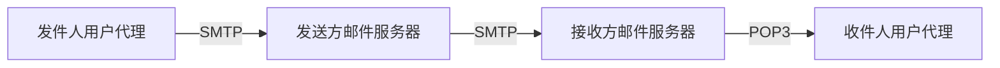
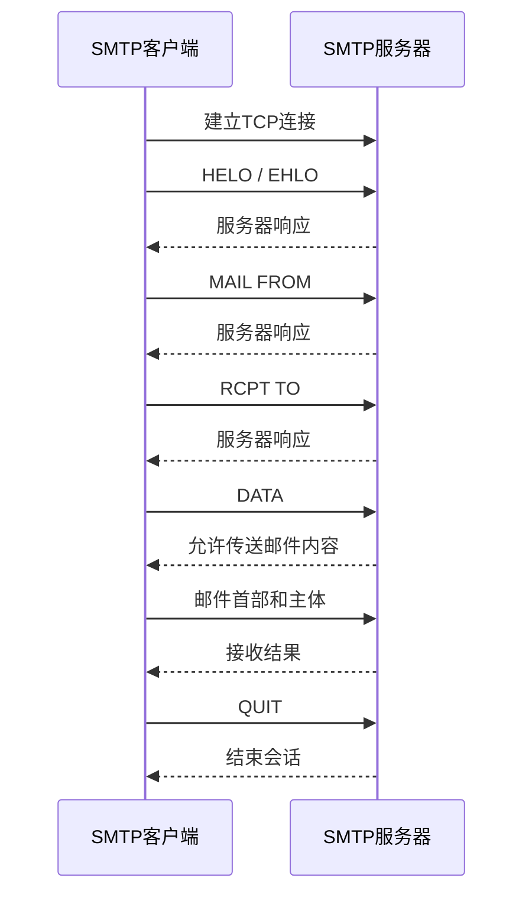
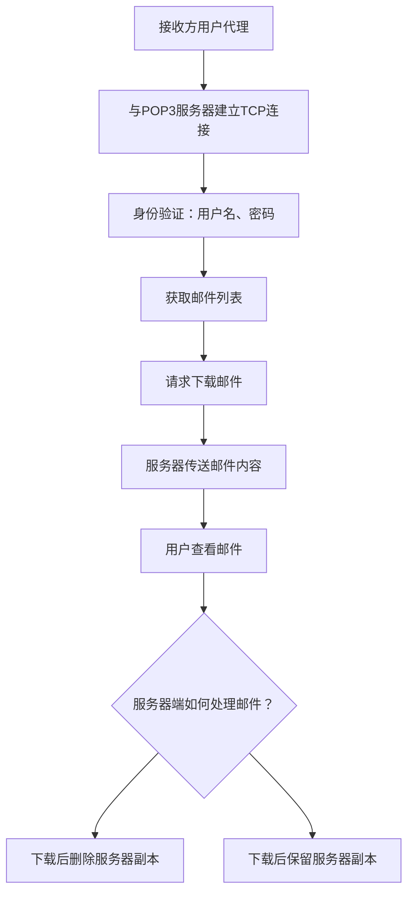
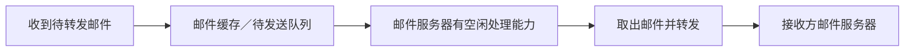
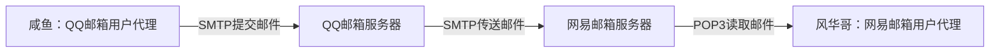

# 计算机网络：电子邮件

> 适用范围：408 计算机网络复习  
> 本节重点：电子邮件系统的组成、电子邮件格式、SMTP、POP3、MIME

## 一、考点概述

电子邮件是非常常见的网络应用。考研大纲主要要求了解：

1. 电子邮件系统的组成结构。
2. 电子邮件的格式。
3. SMTP、POP3 和 MIME 的基本作用。

这部分历年真题通常以比较简单的选择题为主。

### 1. 三个重要缩写

| 名称 | 英文全称                                                    | 基本作用                                              | 是否为通信协议                 |
| ---- | ----------------------------------------------------------- | ----------------------------------------------------- | ------------------------------ |
| SMTP | Simple Mail Transfer Protocol，简单邮件传输协议             | **发送邮件**                                          | 是                             |
| POP3 | Post Office Protocol Version 3，邮局协议第 3 版             | **接收／读取邮件**                                    | 是                             |
| MIME | Multipurpose Internet Mail Extensions，多用途互联网邮件扩展 | 扩展邮件格式，使邮件能够表示非 ASCII 文本及多媒体内容 | **不是通信协议，而是格式规范** |

记忆要点：

- **SMTP：发邮件。**
- **POP3：收邮件。**
- **MIME：扩展邮件内容的表示和编码方式。**

POP3 中的数字 `3` 表示第三个版本，类似于 IPv4、IPv6 中的版本号。

SMTP 和 POP3 都是互联网早期形成的经典协议。虽然现代电子邮件服务也会使用其他机制和协议，但教材仍会介绍它们，因为许多电子邮件系统的基本思想和流程都与它们有关。

---

## 二、电子邮件系统的三大组成部分

电子邮件系统由以下三部分组成：

1. **用户代理**
2. **邮件服务器**
3. **电子邮件协议**

### 1. 用户代理（User Agent）

用户代理就是用户用来编写、发送和接收邮件的应用程序或界面，例如：

- QQ 邮箱 APP；
- 网易邮箱 APP；
- 邮箱网页中的操作界面。

用户代理的主要作用是提供用户界面，让用户能够：

- 编写邮件；
- 发送邮件；
- 接收并查看邮件。

### 2. 邮件服务器（Mail Server）

邮件服务器负责存放用户邮件，以及发送和接收邮件。

例如，假设咸鱼使用 QQ 邮箱，风华哥使用网易邮箱：

1. 咸鱼通过 QQ 邮箱的用户代理编写邮件。
2. 邮件先从咸鱼的用户代理发送到 QQ 邮箱服务器。
3. QQ 邮箱服务器将邮件转发给网易邮箱服务器。
4. 网易邮箱服务器保存收到的邮件。
5. 风华哥通过自己的用户代理，从网易邮箱服务器读取邮件。

在这个过程中，QQ 邮箱服务器和网易邮箱服务器都属于邮件服务器。

### 3. 电子邮件协议（Email Protocol）

邮件系统需要通过协议规定各个部分之间如何通信。本节主要介绍 SMTP 和 POP3。

- 用户代理向发送方邮件服务器提交邮件：使用 SMTP。
- 发送方邮件服务器向接收方邮件服务器传送邮件：使用 SMTP。
- 接收方用户代理从邮件服务器读取邮件：传统场景下可使用 POP3。

SMTP 和 POP3 都采用典型的**客户—服务器（C/S）模式**。同一个邮件服务器在不同通信阶段，可能扮演不同角色。

### 4. 电子邮件系统结构图



> 图中展示的是教材中用于理解 SMTP 和 POP3 的经典邮件流程。现代邮箱网页或 APP 也可能通过 HTTP/HTTPS 等方式与服务端交互。

### 5. SMTP 与 POP3 的角色、端口

#### SMTP

SMTP 用于发送邮件，经典服务端熟知端口号为 **25**。

SMTP 通信的客户端和服务器角色会随通信阶段变化：

| 通信阶段                                   | SMTP 客户端      | SMTP 服务器      |
| ------------------------------------------ | ---------------- | ---------------- |
| 发件人的用户代理向发送方邮件服务器提交邮件 | 发件人的用户代理 | 发送方邮件服务器 |
| 发送方邮件服务器向接收方邮件服务器传送邮件 | 发送方邮件服务器 | 接收方邮件服务器 |

SMTP 使用 TCP 提供的可靠传输服务。客户端需要先与服务器建立 TCP 连接，经典教材场景下会连接服务器的 TCP 25 号端口。

#### POP3

POP3 用于接收或读取邮件，经典服务端熟知端口号为 **110**。

在传统 POP3 通信中：

- 接收方用户代理充当 POP3 客户端；
- 接收方邮件服务器充当 POP3 服务器；
- 客户端与服务器建立 TCP 连接后，按照 POP3 协议读取邮件。

#### IMAP 补充

IMAP 的作用与 POP3 类似，也用于接收方访问邮件服务器中的邮件。IMAP 的功能通常比传统 POP3 更丰富，更适合需要在服务器端管理邮件、并在不同设备间同步邮件状态的场景。

考研大纲重点通常是 SMTP 和 POP3。记住：

- **SMTP 用于发送邮件。**
- **POP3 和 IMAP 用于读取／收取邮件，不能代替 SMTP 负责传统的邮件服务器间发送。**

现代用户通过浏览器访问邮箱网页并发送或读取邮件时，浏览器与网站之间通常会使用 HTTP 或 HTTPS。因此，现代邮件系统中也可能通过 HTTP/HTTPS 实现邮件操作。

---

## 三、电子邮件的格式

一封电子邮件包含两大部分：

1. **信封**
2. **内容**

邮件内容又分为：

1. **首部（Header）**
2. **主体（Body）**

可以用下面的结构理解：

```text
电子邮件
├── 信封（Envelope）
│   ├── 发件人地址
│   └── 收件人地址
└── 内容（Message）
    ├── 首部（Header）
    │   ├── To
    │   ├── From
    │   └── Subject
    └── 主体（Body）
        └── 邮件正文
```

### 1. 邮件首部

常见首部字段如下：

| 字段      | 含义   | 说明           |
| --------- | ------ | -------------- |
| `To`      | 收件人 | 指明邮件发给谁 |
| `From`    | 发件人 | 指明邮件来自谁 |
| `Subject` | 主题   | 概括邮件主题   |

在常见邮件客户端中，收件人和发件人信息通常是发送邮件所需的信息；主题一般可以留空。

注意区分：这里的 `To`、`From`、`Subject` 是邮件**内容中的首部字段**。SMTP 传递邮件时还会使用信封信息，二者相关但不是同一概念。

### 2. 邮件主体

主体就是邮件正文，也就是用户希望传达的主要内容，例如文字、图片或其他附件相关内容。

### 3. 邮件信封

邮件信封主要供 SMTP 等邮件传送过程使用，并不是专门给用户阅读的内容。信封中最重要的信息是：

- 谁发送邮件；
- 邮件要发送给谁。

可以把它类比为寄快递：

- 快递内部装的东西相当于邮件内容；
- 寄件人、收件人和投递地址相当于信封信息；
- 快递员需要知道包裹从哪里来、要送到哪里，但不必理解包裹内部的具体内容。

邮件客户端通常会根据用户填写的信息，生成发送邮件时所需的相关信封信息。

### 4. 邮件格式小结

| 层次         | 组成                    | 主要用途                               |
| ------------ | ----------------------- | -------------------------------------- |
| 一封电子邮件 | 信封 + 内容             | 分别承载传送所需的信息与邮件本身       |
| 邮件内容     | 首部 + 主体             | 首部描述邮件相关信息，主体承载正文内容 |
| 常见首部字段 | `To`、`From`、`Subject` | 收件人、发件人、主题                   |

---

## 四、MIME：扩展电子邮件格式

### 1. 为什么需要 MIME？

在电子邮件协议发展的早期，SMTP 对邮件内容有较严格的限制。经典 SMTP 邮件内容主要按照 **7 位 ASCII 码**的形式传输。

7 位 ASCII 码主要适合表示基本英文字符和常见符号，无法直接表示任意中文字符，也不适合直接表示图片、视频等多媒体数据。

因此，早期 SMTP 存在明显局限：

- 不方便直接表示中文等非 ASCII 字符；
- 不能直接把图片、视频等任意二进制数据当作普通 ASCII 文本发送。

随着互联网的发展，人们需要通过电子邮件传递更多语言的文字和多媒体内容，于是提出了 MIME。

### 2. MIME 的作用

MIME 是一种**邮件格式扩展规范**，不是一个具体的通信协议。

它扩展了邮件的首部字段和主体格式，并定义了邮件内容的编码方式，从而使邮件能够表示：

- 不同字符集的文本；
- 图片等多媒体数据；
- 其他需要编码后传输的内容。

MIME 与 SMTP 的关系可以概括为：

> **MIME 负责按规定的方式描述和编码邮件内容；SMTP 负责按照邮件传送流程传输邮件。**

对于无法直接以 7 位 ASCII 码表示的内容，发送方可以先使用 MIME 规定的编码方式将其转换成符合传输要求的文本形式，再由 SMTP 发送。接收方收到后，再依照相应规则解码并恢复内容。

### 3. MIME 的三个主要方面

MIME 主要包括以下内容：

1. **定义新的邮件首部字段**，用于描述 MIME 版本、内容类型和编码方式等信息。
2. **规定多种邮件主体格式**，例如文本、图片以及多部分邮件的格式。
3. **定义传送编码方式**，其中著名的方式之一是 Base64。

MIME 增加的首部字段不止一个。复习时，重点理解这些字段的用途即可，不需要把所有细节都混为一谈。

### 4. MIME 首部字段示例

常见的 MIME 相关首部字段包括：

| 字段                        | 作用                         |
| --------------------------- | ---------------------------- |
| `MIME-Version`              | 标识所使用的 MIME 版本       |
| `Content-Type`              | 描述主体内容的类型和相关参数 |
| `Content-Transfer-Encoding` | 指明主体采用的传送编码方式   |
| `Content-ID`                | 为某些内容部分提供标识       |
| `Content-Description`       | 对内容作说明                 |

例如，`Content-Type` 可以用来说明某个部分是文本；若文本采用 UTF-8 字符集，也可以通过参数注明字符集。`Content-Transfer-Encoding` 则可以声明该部分采用 Base64 等传送编码方式。

### 5. MIME 多部分邮件的格式

一封邮件可能既有文本，又有一个或多个附件。此时需要规定不同内容部分的边界，以及每个部分自身的类型和编码方式。

下面是一个**用于理解格式的简化示意**，并非完整的实际邮件：

```text
MIME-Version: 1.0
Content-Type: multipart/mixed; boundary="ABC123"

--ABC123
Content-Type: text/plain; charset=UTF-8
Content-Transfer-Encoding: base64

（此处为文本经过 Base64 编码后的内容）
--ABC123
Content-Type: image/jpeg
Content-Transfer-Encoding: base64

（此处为 JPEG 图片经过 Base64 编码后的内容）
--ABC123--
```

说明：

- `multipart/mixed` 表示邮件包含多个不同类型的内容部分。
- `boundary="ABC123"` 指定各部分之间使用的边界标记。
- `--ABC123` 用于分隔不同的内容部分。
- `Content-Type: text/plain; charset=UTF-8` 表示该部分是文本，并使用 UTF-8 字符集。
- `Content-Type: image/jpeg` 表示该部分是 JPEG 图片。
- `Content-Transfer-Encoding: base64` 表示相应部分使用 Base64 传送编码。
- 最后的 `--ABC123--` 表示多部分内容的结束。

边界标记可以由邮件生成方指定。它使接收方能够区分正文文本和不同的附件内容。

### 6. Base64 编码的基本原理

Base64 是一种常见的传送编码方式。它把二进制数据转换为由有限 ASCII 字符构成的文本，以便在只适合传送文本的环境中传输。

可以将它与十六进制进行类比：

- 十六进制使用 16 种符号表示数值，每个十六进制字符对应 4 个比特。
- Base64 使用 64 种字符表示数值，每个 Base64 字符对应 6 个比特，因为 \(2^6=64\)。

Base64 编码的大致过程是：

1. 将原始数据看作一串二进制比特。
2. 按每 6 个比特分组。
3. 将每组的数值映射为 Base64 字符。
4. 按 Base64 规则输出编码后的文本；当输入长度不满足完整分组要求时，可能使用填充字符 `=`。

例如，中文文本和 JPEG 图片在计算机内部都可以表示为二进制数据。采用 Base64 编码后，它们就可以转化为 ASCII 范围内的文本字符，再由 SMTP 传送。接收方再根据编码规则解码，恢复原始数据。

> 注意：Base64 不是加密，也不会让数据变得保密；它只是编码转换。编码后的内容通常会比原始二进制数据更长。

---

## 五、SMTP 的工作过程

SMTP 用于把邮件从发件人的用户代理提交到发送方邮件服务器，也用于把邮件从发送方邮件服务器传送到接收方邮件服务器。

SMTP 采用 **Push（推）** 的方式：由发送方主动发起通信，把邮件推送给下一站服务器。

### 1. 经典 SMTP 流程

在教材中的经典场景下，SMTP 客户端先与 SMTP 服务器建立 TCP 连接，随后使用 SMTP 命令交换信息并传送邮件内容。

常见流程如下：

1. SMTP 客户端主动建立 TCP 连接，经典服务器端口为 TCP 25。
2. 客户端发送 `HELO`（扩展 SMTP 中常见的是 `EHLO`）进行问候。
3. 客户端发送 `MAIL FROM`，声明信封中的发件人地址。
4. 客户端发送 `RCPT TO`，声明信封中的收件人地址。
5. 客户端发送 `DATA`，表示即将开始传送邮件内容。
6. 客户端传送邮件内容，包括首部和主体。
7. 内容传送结束后，客户端发送 `QUIT`，结束会话。

### 2. 常见 SMTP 命令

| 命令            | 作用                         | 复习要点           |
| --------------- | ---------------------------- | ------------------ |
| `HELO` / `EHLO` | 客户端向服务器问候、标识自己 | 会话开始阶段       |
| `MAIL FROM`     | 声明信封发件人               | 属于信封信息       |
| `RCPT TO`       | 声明信封收件人               | 属于信封信息       |
| `DATA`          | 开始传送邮件内容             | 后面传送首部和主体 |
| `QUIT`          | 结束 SMTP 会话               | 传送完成后退出     |

其中，`MAIL FROM` 和 `RCPT TO` 是需要重点关注的命令。它们传递的发件人、收件人信息对应于邮件传送所需的**信封信息**。

注意不要把 `RCPT TO` 与邮件内容首部中的 `To` 混淆：二者有关联，但前者是 SMTP 命令，后者是邮件首部字段。

### 3. SMTP 交互时序示意



> 时序图用于展示命令的典型先后关系。实际 SMTP 会话中的响应码、可选命令和安全机制会因具体实现而有所不同。

### 4. SMTP 使用 TCP

SMTP 使用 TCP 提供可靠传输。邮件内容较长时，数据可以由 TCP 分段传送，再由接收端按 TCP 的机制恢复数据流。

经典教材模型中，SMTP 服务器的熟知端口号是 **25**。

---

## 六、POP3 的工作过程

POP3 用于让接收方用户代理从邮件服务器读取邮件。它采用 **Pull（拉）** 的方式：由客户端主动请求服务器提供邮件。

### 1. 经典 POP3 流程

1. 接收方用户代理作为 POP3 客户端，主动与邮件服务器建立 TCP 连接。
2. 经典 POP3 服务器端口为 TCP **110**。
3. 客户端提交用户名、密码等信息进行身份验证。
4. 身份验证通过后，客户端可以请求查看邮件列表。
5. 客户端请求下载邮件内容。
6. 服务器向客户端传输邮件。
7. 客户端最终在用户代理中查看邮件。

### 2. POP3 的两种下载选择

经典 POP3 可以采用两种常见的邮件处理方式：

| 方式                     | 结果                                     |
| ------------------------ | ---------------------------------------- |
| 下载并删除服务器上的邮件 | 邮件下载到本地后，服务器端对应邮件被删除 |
| 下载并保留服务器上的邮件 | 邮件下载到本地，同时服务器端继续保留邮件 |

具体的邮件客户端行为取决于使用的设置和实现。

### 3. POP3 流程图



### 4. SMTP 与 POP3 的对比

| 对比项         | SMTP                                     | POP3                       |
| -------------- | ---------------------------------------- | -------------------------- |
| 主要作用       | 发送邮件                                 | 接收／读取邮件             |
| 经典通信方向   | 发送方主动将邮件推给服务器               | 客户端主动向服务器请求邮件 |
| 通信方式       | Push（推）                               | Pull（拉）                 |
| 经典服务器端口 | TCP 25                                   | TCP 110                    |
| 常见客户端角色 | 发件人用户代理，或发送方邮件服务器       | 收件人用户代理             |
| 典型用途       | 用户代理提交邮件、邮件服务器之间传送邮件 | 从邮件服务器读取邮件       |

记忆口诀：

> **SMTP 负责推送邮件，POP3 负责把邮件拉回来。**

---

## 七、邮件缓存

邮件服务器可能会持续收到来自不同用户的邮件。如果某封邮件暂时不能立即转发给接收方邮件服务器，就可以先放入邮件缓存中等待处理。

- 邮件缓存通常可以理解为一个待发送队列。
- 服务器有能力继续处理时，会从队列中取出邮件并尝试发送。
- 这有助于缓冲暂时无法立即转发的邮件。

可以用下面的流程表示：



---

## 八、完整邮件流程串联

以咸鱼使用 QQ 邮箱向使用网易邮箱的风华哥发送邮件为例：

1. 咸鱼在 QQ 邮箱的用户代理中填写收件人、主题和正文。
2. 用户代理将邮件提交给 QQ 邮箱服务器；在经典模型中，该环节使用 SMTP。
3. QQ 邮箱服务器作为 SMTP 客户端，连接网易邮箱服务器。
4. 双方通过 SMTP 命令交换信息，并传送邮件内容。
5. 网易邮箱服务器接收并保存邮件。如果邮件暂时无法处理，也可能先进入邮件缓存。
6. 风华哥使用网易邮箱用户代理读取邮件；在经典模型中，该环节可使用 POP3。
7. POP3 客户端完成身份验证、查看邮件列表，并根据需要下载邮件。
8. 邮件下载后，可以按相应设置选择删除服务器副本或保留服务器副本。

### 整体流程图



---

## 九、考点速记

### 1. 必须记住的结论

- 电子邮件系统由**用户代理、邮件服务器、电子邮件协议**三部分组成。
- 电子邮件由**信封和内容**组成；内容又分为**首部和主体**。
- 常见邮件首部字段：`To`、`From`、`Subject`。
- **SMTP 用于发送邮件**，经典服务器端口为 TCP 25。
- **POP3 用于接收／读取邮件**，经典服务器端口为 TCP 110。
- SMTP 和 POP3 都是典型的客户—服务器模式，并使用 TCP。
- SMTP 是 **Push（推）**：发送方主动把邮件推送给服务器。
- POP3 是 **Pull（拉）**：接收方客户端主动请求服务器提供邮件。
- **MIME 不是通信协议，而是邮件格式扩展规范**。
- MIME 扩展邮件首部和主体格式，并定义传送编码方式。
- **Base64 将二进制数据编码为可用 ASCII 字符表示的文本**，常用于邮件内容传送；它不是加密。

### 2. 容易混淆的概念

| 容易混淆的内容         | 正确理解                                                     |
| ---------------------- | ------------------------------------------------------------ |
| SMTP 与 POP3           | SMTP 发送邮件；POP3 读取／收取邮件                           |
| POP3 与 IMAP           | 二者都可用于客户端访问服务器上的邮件；功能与使用方式有所不同 |
| MIME 与 SMTP           | MIME 扩展邮件内容格式；SMTP 负责传送邮件                     |
| 邮件信封与邮件首部     | 信封服务于邮件传送；首部属于邮件内容                         |
| `RCPT TO` 与 `To`      | `RCPT TO` 是 SMTP 命令；`To` 是邮件首部字段                  |
| Base64 与加密          | Base64 是编码，不提供保密性                                  |
| 下载并删除与下载并保留 | POP3 客户端／设置可能选择不同的服务器端邮件处理方式          |

### 3. 端口号快速回顾

| 协议 | 经典熟知端口号 |
| ---- | -------------: |
| SMTP |         TCP 25 |
| POP3 |        TCP 110 |

---

## 十、补充背景：早期的 7 位传输限制

早期通信系统的设计与电报等应用的需求有关，主要面向英文字符和少量符号。在当时的技术背景下，一些通信环境对可传输字符的范围有较严格限制。

SMTP 早期规定邮件内容以 7 位 ASCII 码的形式传送，使它能够适应当时较受限的传输环境。但随着互联网普及，用户开始需要发送中文、图片和其他多媒体数据，单纯依靠基本 ASCII 文本就不够用了。

MIME 通过规定内容类型、编码方式和多部分邮件结构等方法，使这类内容可以先转换为符合传输要求的文本，再由邮件传输机制发送。接收方收到后再解码，恢复相应内容。

这个历史背景有助于理解为什么 MIME 会出现，但它不是本节最主要的考查重点。

---

## 十一、本节总结

本节主要学习了电子邮件系统的组成、邮件格式以及 SMTP、POP3、MIME 的作用。

- **组成结构：** 用户代理、邮件服务器、电子邮件协议。
- **邮件格式：** 信封 + 内容；内容 = 首部 + 主体。
- **SMTP：** 负责发送邮件，经典服务器端口 TCP 25，采用 Push 方式。
- **POP3：** 负责读取／接收邮件，经典服务器端口 TCP 110，采用 Pull 方式。
- **MIME：** 扩展邮件格式，使非 ASCII 文本和多媒体内容能够通过邮件系统传送。
- **Base64：** 将二进制数据转换为 ASCII 字符组成的文本，是编码方式而非加密方式。

复习时，可以结合自己的邮箱实际体验：编写一封邮件，观察收件人、发件人、主题和正文分别对应邮件的哪些部分，再回忆 SMTP、POP3 和 MIME 各自解决的问题。
