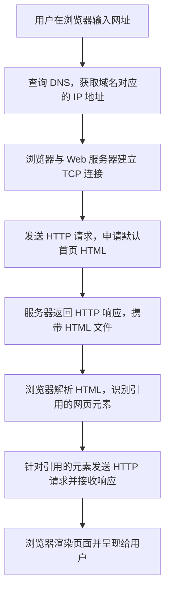
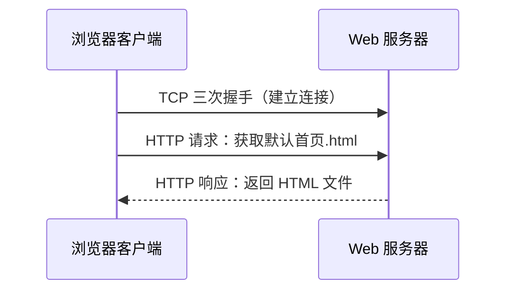
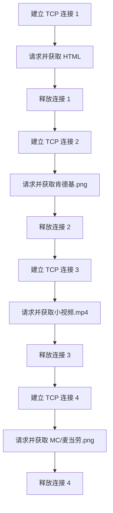
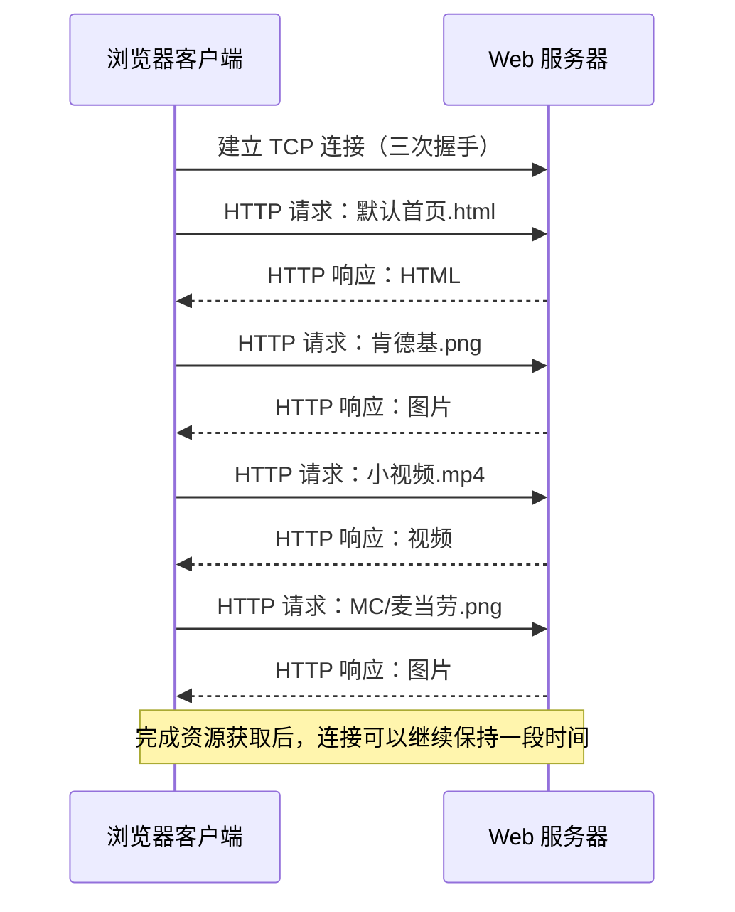
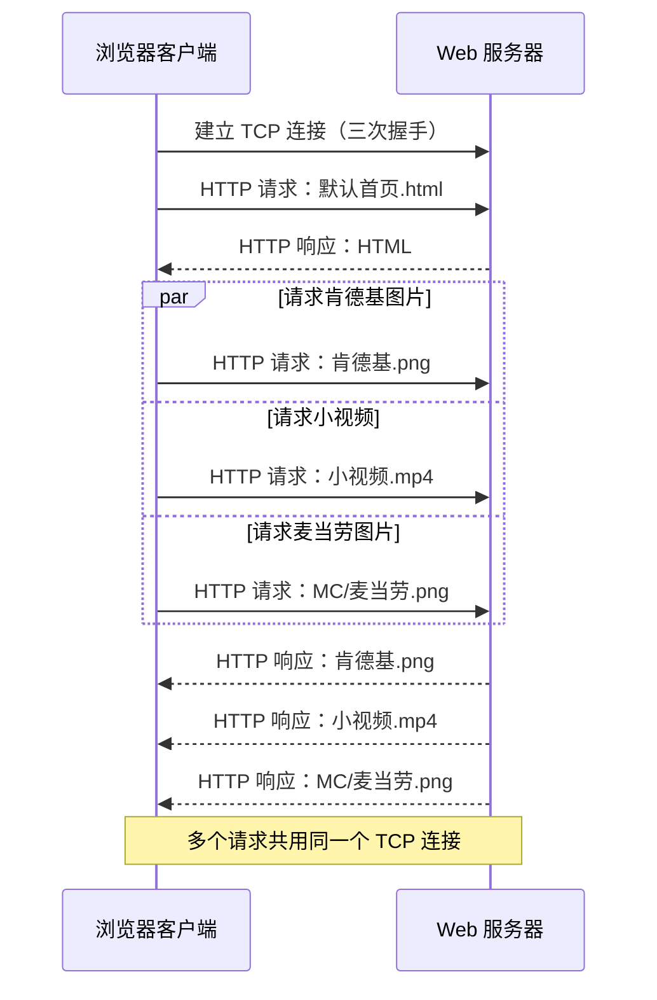
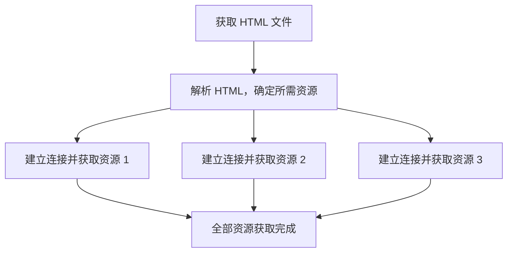
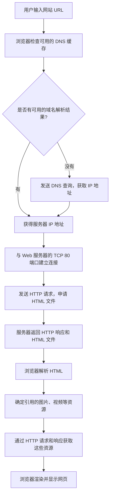
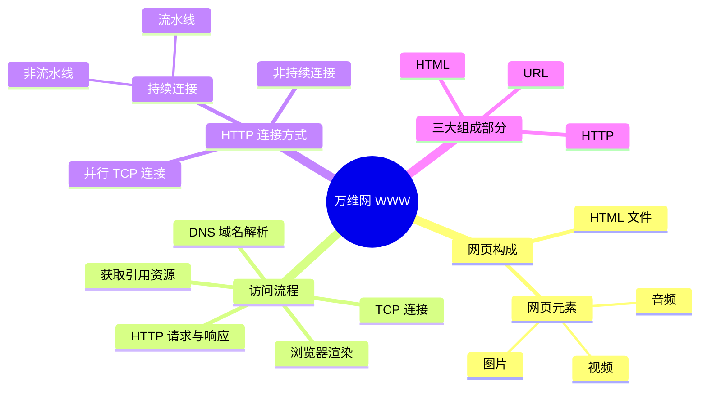

# 408 计算机网络：万维网（WWW）

> 本笔记根据课程字幕整理，主要优化标题层级、段落、表格和示意图，保留原有知识点、例子及讲解逻辑，便于复习、打印和后续查阅。

## 一、万维网概述

万维网（**World Wide Web，WWW**）是 408 计算机网络应用层的最后一个小节。它可以理解为一个**全球范围的、分布式的、联机式的信息存储空间**。

- **全球范围**：信息资源分布在世界各地的服务器上。
- **分布式**：资源并非集中存放在一台服务器上，而是分散存储在不同的 Web 服务器中。例如，B 站服务器存储 B 站的视频资源，其他网站的服务器存储各自的网站资源。
- **联机式**：服务器和客户端通过互联网连接起来，用户可以访问不同服务器上的资源。

普通用户可以通过 HTTP 协议，从互联网上的各个网站获取资源。

## 二、网页由什么组成

### 2.1 一个简单网页的组成

一个网页通常由以下部分组成：

- **一个 HTML 文件**：描述网页的内容、结构，以及要引用的网页元素。
- **若干网页元素**：例如图片、视频、音频等文件。

可以用下面的结构理解：

```text
网站根目录/
├── 默认首页.html
├── 肯德基.png
├── 小视频.mp4
└── MC/
    └── 麦当劳.png
```

在这个例子中，HTML 文件引用了同目录下的 `肯德基.png`、`小视频.mp4`，以及子目录 `MC` 中的 `麦当劳.png`。

浏览器会解析 HTML 文件，根据其中的文字、标签和资源路径找到相应的网页元素，再将它们渲染成最终显示在用户面前的网页。

### 2.2 HTML 文件的作用

HTML（HyperText Markup Language，**超文本标记语言**）文件本质上是具有特定格式要求的字符信息。浏览器会根据 HTML 中的标记，决定如何展示内容。

例如：

```html
<h1>一封求助信</h1>
这是一段正文文字。<br>

<label>好心人请输入你的文字</label>
<input type="text">
<video width="300" height="400" controls>
  <source src="小视频.mp4" type="video/mp4">
</video>
<br>
这是一段视频之后的文字。<br>

```

上面的代码用于说明常见 HTML 标签的作用：

| 标签或属性 | 作用 |
|---|---|
| `<h1>...</h1>` | 将内容标记为一级标题，浏览器通常会以较大、较粗的字体显示 |
| 普通文本 | 没有额外标签时，浏览器按普通正文的样式显示 |
| `<br>` | 换行 |
| `` | 在指定位置显示图片 |
| `src` | 指明图片或视频资源的路径 |
| `width`、`height` | 指定元素的显示宽度和高度；示例中的单位为像素 |
| `<label>` | 为输入控件提供说明文字 |
| `<input>` | 创建输入框等表单控件 |
| `<video>` | 在网页中显示视频 |
| `<source>` | 指明视频文件的路径及媒体类型，例如 `video/mp4` |

HTML 中的资源路径可以指向同一目录中的文件，也可以指向子目录中的文件。例如：

- `肯德基.png`：与 HTML 文件处于同一目录。
- `MC/麦当劳.png`：位于 HTML 文件所在目录下的 `MC` 子目录中。

因此，访问一个本地网页时，本质上就是打开 HTML 文件，再由浏览器解析 HTML 中的信息和资源路径，找到相关文件并渲染页面。

## 三、访问互联网上的网页：整体流程

访问互联网上的网页，与打开本地网页的基本思路相似：浏览器需要先获取 HTML 文件，再根据 HTML 文件中的引用获取其他网页元素。但在获取这些文件之前，还需要完成域名解析，并通过 TCP 与 Web 服务器通信。

### 3.1 场景设定

假设有一台 Web 服务器，部署了某个网站的程序和数据：

- 网站域名示例：`www.dilidili.com`（本例用于说明通信过程）。
- Web 服务器通过一个 Web 服务器进程对外提供服务。
- Web 服务的熟知端口为 **TCP 80 端口**（HTTP 默认端口）。

客户端主机接入学校局域网时，可以通过 DHCP 动态获取网络配置，包括：

- IP 地址；
- 子网掩码；
- 默认网关；
- DNS 服务器地址。

### 3.2 访问网页的主要步骤



整体可以记为：**DNS 域名解析 → TCP 连接 → HTTP 请求与响应 → 获取 HTML → 获取 HTML 引用的资源 → 浏览器渲染网页**。

## 四、第一步：DNS 域名解析

用户在浏览器中输入网址并按下回车后，浏览器首先需要知道域名对应的 IP 地址。

### 4.1 DNS 请求如何传输

浏览器进程构造 DNS 请求报文，指出要查询的域名。随后，报文逐层封装：

1. DNS 请求报文封装为 UDP 数据报。
2. UDP 数据报再封装为 IP 数据报。
3. IP 数据报的源 IP 地址是客户端主机的 IP 地址，目的 IP 地址是客户端配置的 DNS 服务器地址。
4. 本地域名服务器收到数据后，逐层拆封，并检查 UDP 首部中的目的端口号。
5. DNS 服务使用的传输层端口号是 **UDP 53 端口**。DNS 服务器取出 DNS 请求报文，读取其中要查询的域名。

```text
浏览器进程
   │ DNS 请求报文
   ▼
UDP 数据报（目的端口 53）
   │
   ▼
IP 数据报（目的 IP 为 DNS 服务器）
   │
   ▼
本地域名服务器
```

### 4.2 DNS 响应与缓存

本地域名服务器收到请求后，会检查自己的缓存：

- 如果缓存中存在该域名对应的 IP 地址，就可以把查询结果封装成 DNS 响应报文并返回客户端。
- 如果缓存中没有对应记录，则需要继续执行相应的域名解析过程；本例只展示缓存命中的情况。

DNS 响应报文经过 UDP 和 IP 的逐层封装后返回客户端。浏览器收到响应，就知道了域名对应的 IP 地址。

浏览器还可以缓存近期查询结果。这样，在缓存有效且再次访问相同域名时，就有机会直接使用缓存结果，避免重复进行 DNS 查询。

**记忆重点：** 访问网站时，通常需要先通过 DNS 查询获得服务器 IP 地址。DNS 通常使用 UDP，服务器端口号为 53。

## 五、第二步：建立 TCP 连接并请求 HTML

### 5.1 Web 服务器的端口号

HTTP 通常使用 TCP 提供的传输服务。HTTP 的默认熟知端口号是 **TCP 80 端口**。浏览器获得服务器 IP 地址后，可以使用服务器 IP 地址和 TCP 80 端口与 Web 服务器建立 TCP 连接。

TCP 连接的建立需要经过**三次握手**。在本例的讲解中，第三次握手对应的 TCP 报文段可以携带 HTTP 请求报文。

> 说明：三次握手的核心作用是建立 TCP 连接。实际通信中，TCP 数据传输与握手报文的具体配合还会受到协议实现和时序等因素影响；本节示意图采用课程中用于分析 HTTP 访问流程的简化模型。

### 5.2 HTTP 请求报文与响应报文

HTTP（HyperText Transfer Protocol，**超文本传输协议**）规定了两种主要的报文结构：

- **HTTP 请求报文**：客户端向服务器说明希望获取什么资源。
- **HTTP 响应报文**：服务器向客户端返回请求结果及相应资源。

请求报文和响应报文都通过 TCP 传输，因此会被封装在 TCP 报文段中。

例如，浏览器可以请求网站根目录下的 `默认首页.html`。服务器收到请求后，找到相应的 HTML 文件，并将其放入 HTTP 响应报文，再通过 TCP 返回客户端。



### 5.3 解析 HTML 并获取引用资源

浏览器收到 HTML 文件后，会解析其中的内容，发现页面还引用了其他资源。例如：

1. `肯德基.png`
2. `小视频.mp4`
3. `MC/麦当劳.png`

浏览器需要继续向服务器请求这些资源。每个资源都需要通过 HTTP 请求与响应来获取，因此在这个例子中，除首页 HTML 外，还需要获取三个网页元素。

接下来实际的连接与请求过程，会随着 HTTP 采用的连接方式不同而变化。

## 六、HTTP 的连接方式

本节比较三种工作方式：

1. 非持续连接；
2. 持续连接、非流水线方式；
3. 持续连接、流水线方式。

### 6.1 非持续连接（Non-Persistent Connection）

在非持续连接方式下，每完成一次 HTTP 请求和响应，通常就释放当前 TCP 连接。之后请求另一个文件时，再建立新的 TCP 连接。

在本例中，过程如下：

1. 建立第一个 TCP 连接，请求并获取 `默认首页.html`。
2. 释放连接。
3. 建立第二个 TCP 连接，请求并获取 `肯德基.png`，然后释放连接。
4. 建立第三个 TCP 连接，请求并获取 `小视频.mp4`，然后释放连接。
5. 建立第四个 TCP 连接，请求并获取 `MC/麦当劳.png`，然后释放连接。



这里的“非持续”描述的是 **TCP 连接**：一次 HTTP 请求和响应完成后，连接就会被释放。

#### 非持续连接的时间开销

在课程采用的简化分析模型中，每获取一个文件，通常至少需要约 **2 个 RTT**：

- 约 1 个 RTT 用于 TCP 三次握手中建立连接的主要往返过程；
- 再约 1 个 RTT 用于请求报文到达服务器、服务器返回响应开始到达客户端的往返过程。

因此，如果每个资源都使用新的 TCP 连接，连接建立所带来的开销会反复出现。

需要注意：这个结论是在课程常见的简化题目假设下得到的。题目若额外给出响应传输时间、请求大小、并行连接等条件，应按题目条件计算。

### 6.2 持续连接、非流水线方式（Persistent, Non-Pipelined）

在持续连接方式下，获取一个文件后，客户端**不立即关闭 TCP 连接**，而是继续利用已经建立的连接请求下一个文件。

持续连接、非流水线方式的特点是：

- TCP 连接建立后，客户端发送一个 HTTP 请求；
- 等收到该请求对应的响应后，才发送下一个 HTTP 请求；
- 多个请求依次进行，但使用同一个 TCP 连接；
- 相关资源获取完成后，连接可以根据服务器配置继续保持一段时间，之后再释放。



### 6.3 持续连接、流水线方式（Persistent, Pipelined）

持续连接、流水线方式同样使用一个持续的 TCP 连接，但它允许客户端在收到前一个请求的响应之前，连续发送多个 HTTP 请求。

在本例中，浏览器收到 HTML 文件后，知道还需要三个元素，于是可以连续发送三个请求：

- 请求 `肯德基.png`；
- 请求 `小视频.mp4`；
- 请求 `MC/麦当劳.png`。

服务器收到这些请求后，再将相应的响应依次发送给客户端。



### 6.4 三种方式对比

| 比较项目 | 非持续连接 | 持续连接、非流水线 | 持续连接、流水线 |
|---|---|---|---|
| TCP 连接数量 | 通常每个文件建立一个新连接 | 多个文件通常共用一个连接 | 多个文件通常共用一个连接 |
| 请求发送方式 | 每次新建连接后请求一个文件 | 收到上一个响应后再请求下一个文件 | 可以连续发送多个请求，不必等待前一个响应 |
| 是否重复进行连接建立 | 是 | 否（同一连接仍然保持时） | 否（同一连接仍然保持时） |
| 主要特点 | 连接建立、释放开销较多 | 复用连接，但请求与响应按顺序推进 | 复用连接，并减少请求之间的等待 |

### 6.5 持续连接保持多久

持续连接并不意味着传输完网页中的全部资源后就必须立即释放 TCP 连接。服务器可以根据程序和配置，让连接继续保持一段时间；具体保持多久，由服务器端的实现和配置决定。

无论采用持续连接的非流水线方式还是流水线方式，只要属于持续连接，服务器都可以按配置决定连接的保持时间。

### 6.6 非持续连接中，下一次连接可以提前开始

为便于观察每次连接的边界，示意图可能把“释放上一次连接”和“建立下一次连接”分开绘制。但实际情况下，客户端不必等到前一个连接完全释放后，才开始建立下一次连接。新的连接建立过程可以与前一连接的释放过程有时间上的重叠。

在常见的简化题目模型中，非持续连接获取一个文件通常需要约 2 个 RTT，因此会反复产生连接建立开销。

### 6.7 请求报文与响应报文的传输时间

HTTP 请求报文的主要作用是向服务器说明要执行什么请求，通常相对较小；HTTP 响应报文可能携带图片、视频等文件，大小可能明显更大。因此，在分析传输时延时，需要区分请求与响应的大小。

- **小请求报文**：在课程常见的示意图中，通常不强调其传输时延。
- **响应报文携带大文件**：需要考虑文件的传输时延，不能简单忽略。
- **题目特别说明“小文件”**：通常是在提示可以按题目设定，忽略或不计该文件的传输时间；仍应以题目给出的假设为准。

### 6.8 非持续连接也可以并行建立 TCP 连接

在非持续连接方式下，浏览器获取后三个网页元素时，可以通过**并行 TCP 连接**加快获取速度。

关键点在于：

- 浏览器必须先获得 HTML 文件，才能从中知道还需要哪些网页元素。
- 因此，获取第一个 HTML 文件的连接，不能与用于获取 HTML 中引用资源的连接在一开始就同时发起。
- 一旦取得并解析 HTML，浏览器就知道后面需要哪些资源，可以并行建立多个 TCP 连接，请求这些资源。

如果有三个网页元素，并行获取它们可以减少后三个资源串行获取所需的时间；但具体耗时取决于题目中的 RTT、文件大小、连接数量以及其他给定条件，不能脱离条件一概认定严格缩短为原来的三分之一。



## 七、万维网的三大组成部分

万维网的三大组成部分是：

1. **统一资源定位符 URL**（Uniform Resource Locator）；
2. **超文本传输协议 HTTP**（HyperText Transfer Protocol）；
3. **超文本标记语言 HTML**（HyperText Markup Language）。

其中，URL 用于定位资源，HTTP 用于在客户端和服务器之间传送请求与响应，HTML 用于描述网页结构和引用的资源。

### 7.1 URL：统一资源定位符

URL 用来唯一地指向万维网上的某个特定资源。一个常见 URL 的组成结构可以写成：

```text
协议://主机名或 IP 地址:端口号/路径
```

各部分含义如下：

| 部分 | 含义 |
|---|---|
| 协议 | 指明访问资源时使用的应用层协议，例如 `http` 或 `https` |
| 主机名或 IP 地址 | 指明目标服务器；域名可以通过 DNS 解析为 IP 地址 |
| 端口号 | 指明服务器上的目标服务端口；使用默认端口时通常可以省略 |
| 路径 | 指明服务器上的具体资源位置 |

例如：

```text
http://www.dilidili.com/肯德基.png
```

- `http`：指明应用层协议。
- `www.dilidili.com`：指明服务器域名，域名可通过 DNS 查询到对应 IP 地址。
- URL 中没有显式写出端口号：HTTP 默认端口为 80 时，端口号通常可以省略。
- `/肯德基.png`：指明想获取的资源路径。

### 7.2 URL 中的默认首页

访问网站时，URL 可以不写出具体页面路径。例如，输入网站域名后，服务器通常会根据网站配置返回默认首页。课程中举出的常见默认首页文件名是 `index.html`。

如果 URL 没有指明要访问的具体页面，服务器通常会根据自身配置返回默认首页；这属于网站服务器的配置与处理方式。

当用户点击网站中的其他链接时，地址栏中可能会出现更具体的路径。

### 7.3 HTTP 与 HTTPS

- **HTTP**：超文本传输协议，用于客户端与 Web 服务器之间的请求和响应。
- **HTTPS**：在 HTTP 通信基础上使用 TLS 等机制保护通信，提供加密以及身份验证、完整性保护等安全能力。

HTTPS 的 URL 通常以 `https://` 开头。HTTPS 的默认端口通常为 443，而 HTTP 的默认端口通常为 80；因此，使用 HTTPS 时也不能把 80 端口一概视为默认端口。

### 7.4 HTTP 的版本与连接方式

课程中的重点结论：

- **HTTP/1.0** 默认采用非持续连接方式。
- **HTTP/1.1** 默认采用持续连接方式。
- 如果 HTTP/1.1 不希望使用持续连接，可以在 HTTP 请求报文中设置：

```http
Connection: close
```

这表示请求方希望在当前响应完成后关闭连接，而不是继续保持持久连接。

## 八、访问一个网页时，背后发生了什么

下面将整个过程串联起来，便于做综合题时按层次分析。



### 复习时的分层视角

| 阶段 | 关键协议或信息 | 作用 |
|---|---|---|
| 获取网络配置 | DHCP | 获取 IP 地址、子网掩码、默认网关、DNS 服务器地址等参数 |
| 域名解析 | DNS、UDP 53 | 查询域名对应的 IP 地址 |
| 建立通信 | TCP 三次握手 | 在客户端和 Web 服务器之间建立 TCP 连接 |
| 请求网页 | HTTP | 指明想获取的 HTML 或其他资源 |
| 返回数据 | HTTP 响应、TCP | 将 HTML、图片、视频等资源返回客户端 |
| 页面展示 | HTML 解析与浏览器渲染 | 根据网页结构和引用资源生成最终页面 |

## 九、考试复习要点

1. **网页由 HTML 文件和若干网页元素组成。** HTML 描述页面结构，并通过路径引用图片、视频等资源。
2. **浏览器访问网页时，通常先进行 DNS 域名解析。** DNS 通常使用 UDP，服务器端口号为 53。
3. **HTTP 通常使用 TCP 提供的传输服务。** HTTP 默认熟知端口为 TCP 80。
4. **HTTP 请求报文用于说明客户端想获取什么；响应报文用于返回结果和资源。**
5. **HTTP/1.0 默认非持续连接，HTTP/1.1 默认持续连接。**
6. **持续连接分为非流水线和流水线方式。** 非流水线方式通常等收到前一个响应后再发送下一个请求；流水线方式允许连续发送多个请求。
7. **非持续连接可以使用并行 TCP 连接。** 但需要先获取 HTML，才能确定其中引用的资源。
8. **分析时延题要分清 RTT、连接建立、请求响应过程和文件传输时延。** 小文件、忽略传输时延等条件都应根据题目给出的假设处理。
9. **万维网三大组成部分：URL、HTTP、HTML。** URL 定位资源，HTTP 传送请求和响应，HTML 描述网页。
10. **URL 常见组成：协议、主机名或 IP 地址、端口号、路径。** 默认端口和默认首页路径在满足相应条件时可以省略。

---

## 十、快速记忆图


