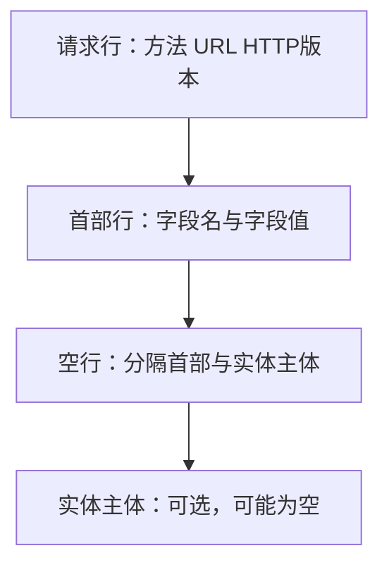
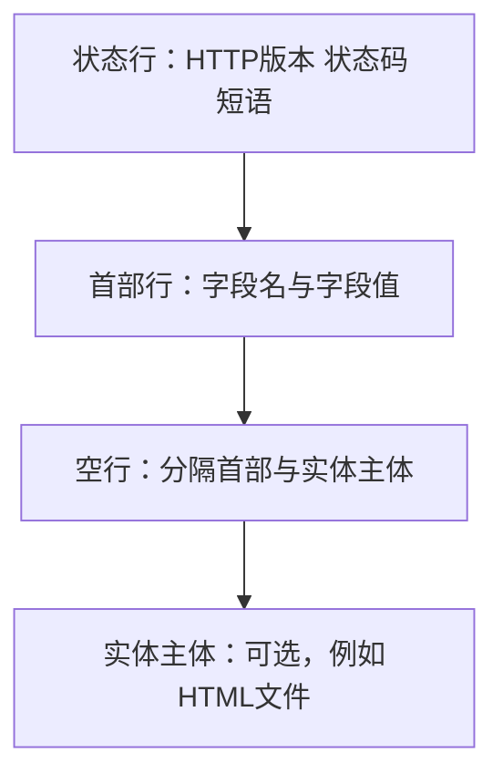
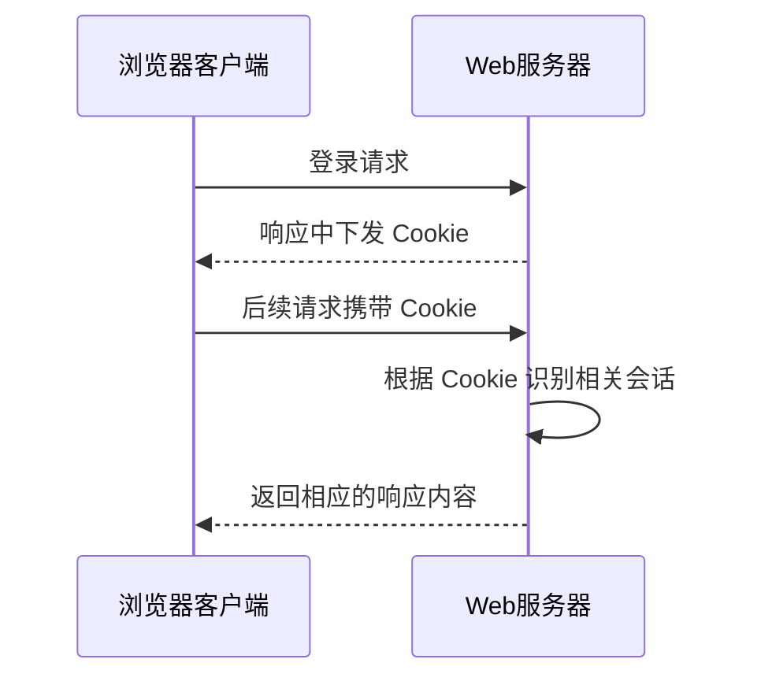

# HTTP 协议学习笔记

> 计算机网络 · 应用层  
> 本节重点：HTTP 报文格式、常见请求方法、状态码、`Host` / `Connection` / `Cookie` 字段，以及 2015 年真题。

---

## 一、HTTP 报文概述

HTTP 通信包含两类报文：

- **请求报文**：由客户端（例如浏览器）发送给服务器。
- **响应报文**：由服务器返回给客户端。

可以把 HTTP 请求和响应**类比为一次远程函数调用**：

- 请求报文中的**方法**可以类比为要调用的函数。
- URL 指明要访问的资源，可以理解为调用参数的一部分。
- 请求首部中的各种字段可以类比为其他调用参数。
- 响应报文相当于函数调用的返回结果，服务器可以在响应的实体主体中返回请求的文件。

例如，浏览器请求服务器上的默认首页 `index.html`，可以理解为浏览器希望服务器执行相应的处理，并将结果返回。

> 说明：远程函数调用只是帮助理解 HTTP 的类比；HTTP 方法并不是真的在网络上直接调用某个编程语言函数。

---

## 二、HTTP 请求报文

### 2.1 请求报文的整体结构

请求报文主要由以下部分组成：

1. **请求行**：方法、URL、HTTP 版本。
2. **首部行**：若干个字段名及其对应的字段值。
3. **空行**：用于分隔首部和实体主体。
4. **实体主体**：可选，通常可以为空。



### 2.2 请求行

请求行的基本格式为：

```text
方法 URL HTTP版本
```

三个部分之间使用空格分隔，行末使用 **CRLF（回车换行符）**。

| 字段           | 含义                                                   |
| -------------- | ------------------------------------------------------ |
| 方法（Method） | 指明客户端希望服务器执行哪类操作                       |
| URL            | 指向服务器上的某个具体资源，例如图片、视频或 HTML 文件 |
| HTTP 版本      | 指明请求采用的 HTTP 版本，例如 `HTTP/1.0`、`HTTP/1.1`  |

例如：

```http
GET /index.html HTTP/1.1
```

这表示客户端希望使用 `GET` 方法获取 `/index.html` 资源，并采用 HTTP/1.1。

### 2.3 首部行

请求行后面是若干行首部字段，每一行由字段名和字段值组成，通常写成：

```text
字段名: 字段值
```

首部字段用于向服务器提供请求相关的信息。可以把它们类比为远程函数调用时传递的参数，让服务器根据这些信息处理请求。

常见且本节需要重点关注的字段包括：

- `Host`：指明要访问的主机。
- `Connection`：指明连接的工作方式。
- `Cookie`：携带服务器此前下发给客户端的 Cookie 信息。

每一行首部字段的末尾也使用 CRLF。

### 2.4 空行与实体主体

首部行结束后，会出现一个空行，用来分隔首部和实体主体。

**实体主体（Entity Body）是可选的**。大多数普通请求报文的实体主体为空；在一些需要向服务器提交数据的场景中，实体主体可以携带数据。例如，上传图片时，图片数据可以放在请求报文的实体主体中。

---

## 三、HTTP 常见请求方法

本节重点了解 `GET`、`HEAD`、`POST`，以及与代理服务器有关的 `CONNECT`。

| 方法      | 主要作用                                 | 理解要点                                                   |
| --------- | ---------------------------------------- | ---------------------------------------------------------- |
| `GET`     | 请求服务器返回 URL 指向的资源            | 客户端向服务器获取内容，例如图片、视频或 HTML 文件         |
| `HEAD`    | 类似 `GET`，但不返回资源的实体主体       | 服务器返回状态行和首部信息，客户端可以先了解资源的相关信息 |
| `POST`    | 向服务器提交需要处理的数据               | 例如，浏览器把账号、密码等信息发送给服务器处理             |
| `CONNECT` | 与代理服务器等场景有关，用于建立连接隧道 | 本节只需有印象，考察概率相对较低                           |

### 3.1 GET 方法

`GET` 用于请求 URL 所指向的资源，例如向服务器请求一张图片、一个视频或一个 HTML 文件。

```http
GET /index.html HTTP/1.1
```

### 3.2 HEAD 方法

`HEAD` 可以理解为类似 `GET` 的方法，但服务器**不在响应中返回资源的实体主体**，只返回状态行和首部信息。

它的用途之一是：客户端先询问服务器某个资源的相关信息，而不必接收完整文件，从而减少这次请求所需传输的数据量。

### 3.3 POST 方法

`POST` 用于向服务器发送需要处理的数据。例如，用户登录时，浏览器可能通过 POST 请求向服务器提交账号、密码等信息。

可以用下面的方式进行区分：

- **GET**：客户端向服务器索取资源。
- **POST**：客户端向服务器提交需要处理的数据。

### 3.4 CONNECT 方法

`CONNECT` 与代理服务器等场景有关。本节讲解中强调，它的考察概率相对较低，了解即可。

> **术语提醒：** `CONNECT` 是请求方法；`Connection` 是首部字段。两者不是同一个概念。

---

## 四、HTTP 响应报文

### 4.1 响应报文的整体结构

响应报文主要由以下部分组成：

1. **状态行**：HTTP 版本、状态码、短语。
2. **首部行**：若干个字段名及其对应的字段值。
3. **空行**：分隔首部和实体主体。
4. **实体主体**：可选，常用于携带服务器返回的文件或页面内容。



### 4.2 状态行

状态行的基本格式为：

```text
HTTP版本 状态码 短语
```

| 字段      | 含义                                             |
| --------- | ------------------------------------------------ |
| HTTP 版本 | 指明响应采用的 HTTP 版本，例如 `HTTP/1.1`        |
| 状态码    | 通常由三个十进制数字组成，用于表示请求处理的状态 |
| 短语      | 对状态码含义的简要说明                           |

例如：

```http
HTTP/1.1 404 Not Found
```

其中：

- `HTTP/1.1`：版本信息。
- `404`：状态码，表示请求的 URL 所指向的资源没有找到。
- `Not Found`：短语，对状态码含义进行说明。

### 4.3 常见状态码及其类别

通常可以根据状态码的第一位数字判断它所属的类别。本节重点涉及以下内容：

| 类别或示例        | 含义                                                 |
| ----------------- | ---------------------------------------------------- |
| `1xx`，例如 `100` | 本节仅将其作为三位状态码的示例提及，未展开讲解       |
| `2xx`，例如 `200` | 请求成功。资源存在且请求成功时，响应中可能出现 `200` |
| `201`             | 本节将其作为状态码示例提及，未展开讲解               |
| `4xx`，例如 `404` | 客户端错误。`404 Not Found` 表示请求的资源不存在     |
| `5xx`             | 服务器端错误                                         |

浏览器通常不会把所有响应报文中的状态码直接展示在普通网页上。不过，可以打开浏览器的开发者工具，查看请求、响应及相关状态信息。

### 4.4 响应首部与实体主体

状态行后面是若干首部字段，每一行同样使用“字段名: 字段值”的形式，并以 CRLF 结束。

所有首部字段结束后，会出现一个空行；空行之后是可选的实体主体。例如，服务器可以在实体主体中携带 HTML 文件。浏览器收到 HTML 后，会解析并渲染其中的内容，再展示给用户。

---

## 五、HTTP 报文实例

### 5.1 请求图片并收到 404 响应

讲解中的例子是：在浏览器中输入一个指向百度服务器上 `xianyu.png` 图片的 URL，尝试访问服务器根目录下的这张图片，但服务器返回了 `404 Not Found`。

从浏览器最终展示的错误页面，可以理解为服务器没有找到该 URL 对应的资源。

### 5.2 请求报文示意

请求报文的第一行包含方法、URL 和 HTTP 版本；后面的首部字段提供主机、连接方式、Cookie 等信息。

```http
GET /xianyu.png HTTP/1.1
Host: www.baidu.com
Accept: ...
Accept-Encoding: ...
Connection: keep-alive
Cookie: ...
```

> 上面是用于说明报文结构的示意写法。实际请求中可能包含更多首部字段，字段值也会因浏览器和请求内容而不同。

逐项理解：

- `GET`：希望从服务器获取资源。
- `/xianyu.png`：要访问的资源路径。
- `HTTP/1.1`：采用 HTTP/1.1。
- `Host`：指明要访问的主机名。
- `Connection: keep-alive`：请求采用持续连接方式。
- `Cookie`：如果请求中包含 Cookie，说明客户端携带了相应的 Cookie 信息。

### 5.3 响应报文示意

服务器返回的响应状态行可能如下：

```http
HTTP/1.1 404 Not Found
```

响应报文的实体主体中还可以包含服务器生成的 HTML 错误页面。浏览器收到该 HTML 后，会将其内容渲染出来，最终显示 `404 Not Found` 错误页面。

需要区分：

- **状态行中的 `404 Not Found`**：表示请求资源未找到。
- **实体主体中的 HTML**：用于呈现错误页面的具体内容。

---

## 六、三个重要的 HTTP 首部字段

本节特别强调 `Connection`、`Host` 和 `Cookie`。

### 6.1 Connection：持续连接还是非持续连接

`Connection` 首部字段用于指明 HTTP 连接的工作方式。

| 字段值                   | 含义                                           |
| ------------------------ | ---------------------------------------------- |
| `Connection: keep-alive` | 使用持续连接                                   |
| `Connection: close`      | 使用非持续连接，即本次连接不按持续连接方式保持 |

HTTP 版本的默认连接方式需要重点记忆：

| HTTP 版本 | 默认连接方式       |
| --------- | ------------------ |
| HTTP/1.0  | 默认采用非持续连接 |
| HTTP/1.1  | 默认采用持续连接   |

这里的“默认”是指：**如果请求报文没有显式指明 `Connection` 的连接方式，就采用相应版本的默认方式。**

因此，HTTP/1.1 并不意味着每个请求都一定使用持续连接；如果报文中明确写了 `Connection: close`，则表示采用非持续连接。

### 6.2 Host：要访问的主机

`Host` 首部字段指明请求所针对的主机名。例如：

```http
Host: www.test.edu.cn
```

这表示请求要访问的主机是 `www.test.edu.cn`。

### 6.3 Cookie：识别客户端状态

Cookie 可以帮助服务器区分与自己通信的客户端或用户。讲解中将 Cookie 类比为服务器发给客户端的一张**临时身份证**。

#### Cookie 的基本工作过程

1. 用户登录网站后，服务器生成或分配相应的 Cookie 信息。
2. 服务器在响应中把 Cookie 信息发送给客户端。
3. 客户端保存 Cookie。
4. 后续客户端再次向服务器发送 HTTP 请求时，可以在请求中携带 Cookie。
5. 服务器根据 Cookie 信息识别相关会话，并据此提供相应的个性化服务。



例如，用户登录淘宝后，服务器可能将该用户对应的 Cookie 信息保存下来，同时发送给浏览器。此后，浏览器再次访问网站时携带 Cookie，服务器便可以据此识别相关用户或会话，并提供不同的个性化内容，例如商品推荐。

#### Cookie 的有效期

Cookie 通常具有有效期。过期后，客户端原先携带的 Cookie 可能不再有效，网站可能要求用户重新登录。

例如，用户登录网站后，过了两三天又被要求重新登录，可能与此前的 Cookie 已过期有关。

> 本节使用“临时身份证”帮助理解 Cookie 的作用。实际应用中的 Cookie 字段和会话管理机制可能比较复杂，但核心理解是：客户端保存并在后续请求中携带 Cookie，服务器据此识别相关状态。

---

## 七、2015 年真题第 40 题

### 7.1 题目所考查的请求报文

题目给出浏览器发送的 HTTP 请求报文，关键部分可以整理为：

```http
GET /index.html HTTP/1.1
Host: www.test.edu.cn
Connection: close
Cookie: 123456
```

题目要求判断选项中的描述哪一项错误。讲解给出的答案是 **C**。

### 7.2 逐项分析

**A 选项：浏览器请求 `index.html`。**

正确。请求行中的 URL 是 `/index.html`，因此浏览器请求该资源。

**B 选项：`index.html` 存放在 `www.test.edu.cn` 上。**

正确。`Host` 字段的值是 `www.test.edu.cn`，指明请求所针对的主机。

**C 选项：浏览器请求使用持续连接。**

错误。报文中明确写着：

```http
Connection: close
```

`close` 表示采用非持续连接，而不是持续连接。因此 C 是错误选项。

**D 选项：浏览器曾经浏览过这个网站。**

按照题目给定的语境，该请求携带了：

```http
Cookie: 123456
```

这表示浏览器已经携带相应的 Cookie 信息。结合题目背景，可以判断浏览器此前与该服务器发生过交互，并获得了 Cookie。因此，D 是正确选项。

### 7.3 这道题需要掌握的知识

- 请求行的格式：**方法 + URL + HTTP 版本**。
- `Host` 字段用于指明请求的主机。
- `Connection: close` 表示非持续连接。
- `Connection: keep-alive` 表示持续连接。
- 请求中出现 Cookie，说明客户端携带了 Cookie 信息。
- HTTP/1.0 默认采用非持续连接，HTTP/1.1 默认采用持续连接；默认方式适用于报文没有显式指定连接方式的情况。

---

## 八、本节内容总结

### 8.1 请求报文与响应报文对比

| 对比项         | 请求报文                               | 响应报文                     |
| -------------- | -------------------------------------- | ---------------------------- |
| 第一行名称     | 请求行                                 | 状态行                       |
| 第一行主要内容 | 方法、URL、HTTP 版本                   | HTTP 版本、状态码、短语      |
| 后续部分       | 首部字段、空行、可选实体主体           | 首部字段、空行、可选实体主体 |
| 本节重点       | 请求行、`Host`、`Connection`、`Cookie` | 状态行、状态码、实体主体     |

### 8.2 重点请求方法

| 方法      | 记忆要点                                           |
| --------- | -------------------------------------------------- |
| `GET`     | 从服务器获取指定资源                               |
| `HEAD`    | 类似 GET，但不返回实体主体，只返回状态行和首部信息 |
| `POST`    | 向服务器提交需要处理的数据                         |
| `CONNECT` | 与代理服务器等场景有关，本节了解即可               |

### 8.3 重点字段

| 字段         | 记忆要点                                                     |
| ------------ | ------------------------------------------------------------ |
| `Host`       | 指明要访问的主机名                                           |
| `Connection` | `keep-alive` 表示持续连接；`close` 表示非持续连接            |
| `Cookie`     | 客户端保存并在后续请求中携带，服务器可据此识别相关会话或状态 |

### 8.4 复习清单

- [ ] 能写出 HTTP 请求报文的基本结构。
- [ ] 能写出 HTTP 响应报文的基本结构。
- [ ] 能区分请求行与状态行。
- [ ] 理解 `GET`、`HEAD`、`POST`、`CONNECT` 的主要用途。
- [ ] 记住 `200` 表示请求成功，`404 Not Found` 表示请求资源未找到。
- [ ] 理解 `Host`、`Connection` 和 `Cookie` 三个首部字段。
- [ ] 记住 HTTP/1.0 默认采用非持续连接，HTTP/1.1 默认采用持续连接。
- [ ] 能根据 `Connection: close` 判断请求使用非持续连接。
- [ ] 理解 Cookie 的基本交互过程及有效期概念。
- [ ] 复习 2015 年真题第 40 题的判断过程。

---

## 九、与前一节内容的联系

复习 HTTP 时，不要只记本节的报文格式和字段，还需要和前一节内容放在一起理解：

1. **HTTP 的工作过程**：浏览器发送请求，服务器接收并处理请求，然后返回响应。
2. **HTTP 的工作方式**：重点理解持续连接与非持续连接的区别，以及 HTTP/1.0、HTTP/1.1 的默认连接方式。
3. **HTTP 报文格式**：通过请求行、首部字段、状态行和实体主体，理解请求与响应具体如何表达。

本节补充的是 HTTP 报文格式、常见方法、状态码和 Cookie 等相关概念。复习时建议结合报文实例和 2015 年真题一起掌握。
